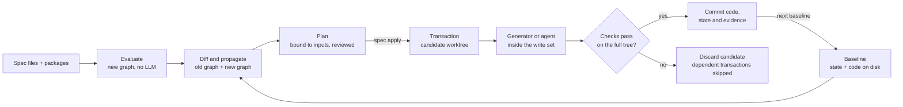

# Spec language: design draft v0.1

Working copy. v0 was exported on 2026-11-18; `REVIEW.md` is the self-review of v0,
`DECISIONS.md` logs every change since, and `rounds/` holds the design rounds.

## Summary

A small declarative language whose programs evaluate to a **spec graph**: typed
declarations (pages, entities, actions, rules) joined by typed edges. A CLI diffs that
graph against recorded state and the code on disk, prints a reviewable plan, and applies
it as a series of verified transactions, each handed to an agent as a scoped work order.

Working names: files end in `.spec`, the CLI is `spec` (`spec plan`, `spec apply`).

| Decision | Choice | Why |
| --- | --- | --- |
| Syntax | Own declarative syntax that lowers to a JSON graph | A plan must be computable without running arbitrary code. Humans review the syntax; tools consume the graph. |
| Identity | Every declaration has an address: module path + name | Changing a route, a prompt or even the kind is an update, not delete-and-recreate. |
| Status of code | Code is committed and is an input to every change | LLM output is not reproducible, so changes edit the baseline instead of regenerating it. |
| Unit of apply | A transaction: one changed declaration plus the dependents it breaks | An interface change and its callers cannot pass checks separately. |
| Modules | A directory is a module; context inherits project → module → declaration | Splitting files needs no ceremony; module boundaries bound what an agent reads. |
| Framework constructs | Kinds such as `nextjs.page` come from packages | The core stays small. |
| State | One record per managed declaration, committed beside the code | Each branch carries its own baseline. |
| Trust | Baseline and evidence are separate; evidence names the tree it ran on | "Applied" means checks passed on this code, not that an agent said so. |

## Goals and non-goals

A human reviews changes to intent; an agent works out the code.

Goals:

- **Deterministic evaluation.** The same files always produce the same graph and plan. No LLM runs before `apply`.
- **Incremental change.** One edited declaration produces one scoped transaction, not a rebuild.
- **Brownfield first.** Existing code is adopted piece by piece; hand-written parts stay hand-written.
- **Deterministic tools before agents.** Where a generator or codemod can make a change, the plan uses it.
- **Visible trust.** Every requirement shows how, and on which tree, it was verified.

Non-goals:

- **A general-purpose language.** No loops, I/O or user-defined functions.
- **Replacing code.** Implementation detail stays in code. The spec says what and why.
- **Reproducible builds from the spec alone.** State and baseline code are part of the system.
- **Formal verification.** Prose is first-class and partly unverifiable; the design exposes that.

## Core model

### Declarations

A project evaluates to a graph of declarations. There are two sorts:

- **Managed declarations** own outputs (files) and have a state record: pages, actions,
  entities, components, endpoints.
- **Context declarations** own nothing and have no state record: `project`, `stack`,
  `use`, `module`, `rule`, `type`, `extern`. They feed the context or public projections
  of the declarations that reference or inherit them. They still have addresses, and
  their effects are recorded in the state of each managed declaration they reach.

Every declaration has four layers. The rule is to move information up the table.

| Layer | Example | Checked |
| --- | --- | --- |
| Structure: typed fields defined by the kind | `route: "/login"`, entity fields | By the compiler |
| References: typed edges | `calls: [sign_in]`, `@{dashboard.home}` in prose | By the compiler; dangling is an error |
| Intent: prose | `prompt: """..."""` | Read by the agent |
| Acceptance: named `expect` members | `redirects: "valid credentials redirect to ..."` | After apply, by checks |

### Identity

A declaration's **address** is its module path plus its name: `auth.login`,
`core.Workspace`. The kind is not part of the address, so names are unique within a
module across all kinds, and a kind change keeps the address (and plans as `replace`).

**Members.** Anything inside a declaration that state, evidence or a migration tracks has
a member address `decl#collection.key`. Each kind's schema declares its *addressable
collections*; members are always keyed by name, never by position or text hash:

| Collection | Example address | Declared by |
| --- | --- | --- |
| `expect` | `auth.login#expect.redirects` | core, every declaration |
| `errors` | `auth.sign_in#errors.invalid_credentials` | core, `action` |
| `input`, `output` | `auth.sign_in#input.email` | core, `action` |
| `fields` | `core.Workspace#fields.name` | core, `entity` |
| `outputs` | `auth.login#outputs.page` | the kind's package |
| `contributes` | `auth.login#contributes.nav` | the kind's package |

Keys are unique within a collection; `#fields.name` and `#expect.name` are distinct.

**Other identities.** A package catalog symbol is identified by its canonical package and
export path (`npm:ui-sdk::input`), never by the alias it was imported under, and appears
only in graph JSON and state. A capability is identified by its name; its provider and
options are inputs. An output is identified by its slot (`#outputs.page`); its file path
is a locator that may change, so a route edit moves a file rather than deleting one.
`extern` keeps its address while its `source` locator changes.

### Moves

`moved` asserts that two addresses denote one continuing thing:

```spec
moved auth.login -> auth.sign_in
moved module billing -> payments
moved auth.sign_in#expect.redirects -> auth.sign_in#expect.valid_redirect
moved core.Workspace#fields.name -> core.Workspace#fields.title
```

Moves are resolved into one mapping before the diff. The most specific source wins at
each step, chains are followed to their end, and the mapping must be one-to-one:

| Case | Result |
| --- | --- |
| Rename without `moved` | Delete plus create. The plan may *suggest* a `moved` when bodies are near-identical. |
| `a -> b`, later `b -> c` | Both `a` and `b` resolve to `c`. |
| `a -> b` and `b -> a` | Compile error. |
| Two baseline objects reach one target | Compile error: moves cannot merge. |
| Source and target both have state | Collision error; target state is never overwritten. |
| Source absent from this baseline | No-op here, reported as such. |
| Source and target in different collections | Compile error: an expectation cannot become a field. |
| A new declaration reuses a moved-away source address | Compile error while the `moved` statement exists. |

A move preserves history; it does not make the change free. Renaming an entity field is a
semantic `rename_field`, which the database package lowers to a column rename (or to
nothing, if the column name is pinned). If it cannot preserve data, the plan fails rather
than falling back to drop-and-add. Moving an expectation to another declaration carries
its test binding but requires its coverage to be reassessed, and both declarations join one
transaction. Splitting or merging members needs an explicit change, not several moves.

`moved` statements stay in the spec indefinitely. A local planner cannot know which
branches still hold old state, so it never reports a move as safe to delete.

**Branch merges.** After a merge, `spec plan` reconciles identity three-way against the
merge base: it applies one branch's edits through the other branch's moves, reports two
different destinations for one source as an identity conflict, and reports two state
records claiming one output as an ownership conflict.

### Edges and relations

Every edge has a **relation**, fixed by the kind field it comes from. A relation states
three things: what it **consumes** from the target, whether it **orders** work, and what
**imports** it grants to the source's code.

| Relation | Comes from | Consumes | Orders | Grants imports |
| --- | --- | --- | --- | --- |
| `calls` | `calls` | target's public projection | yes | target's public entry points |
| `reads`, `writes` | `reads`, `writes` | entity schema | yes | entity's data-access module |
| `uses` | `uses` | component or catalog contract | yes | target's runtime exports |
| `types` | a type position, e.g. `output: Workspace` | type shape | yes | type-only imports |
| `requires` | `requires` | capability contract | no | bound package's runtime exports |
| `mentions` | `@{...}` in prose or `expect` | target's public projection | no | none |

Package kinds may declare further relations with the same three properties. Reference
cycles are legal; only cycles among changes that must be made jointly merge (see
Transactions).

### Projections and hashes

Hashes are computed over canonical projections of the graph, never over source text.
Canonical form resolves references to addresses, fills defaults, sorts unordered fields
and normalises prose whitespace.

| Projection | Covers | Invalidates |
| --- | --- | --- |
| `public` | `summary` plus fields the kind marks as interface (a route, an action signature, entity fields), with type references resolved to their own public projections | Dependents, through the edges that consume it |
| `body` | Everything else the declaration states: prompt, hint, expect, uses | The declaration itself |
| `context` | Inherited project and module prompts, matching rules, and package components: skills, output conventions, checks, generators, each hashed separately | The declaration, as a `verify` obligation |

Because type references resolve recursively, changing a shared `type` changes the public
projection of every action whose signature mentions it, and so reaches their callers.
`extern` declarations record a hash of the source symbol they point to, so editing that
code changes their public projection.

State stores, for each outgoing edge, the hash of the projection consumed at the last
apply. Planning compares these, so a dependent is invalidated exactly when what it
consumed changed.

### Evidence

The **baseline** is the set of output hashes a human or a passing transaction accepted.
**Evidence** for a requirement has two parts, kept separately:

- **Coverage**: a judgement that a given test covers a given revision of the
  requirement's text. It is made by a reviewer that did not write the code (a human or a
  separate agent) and records the requirement's contract hash and the test's definition
  hash.
- **Run**: the test passed, on a recorded git tree, under a recorded check definition.

A requirement is `tested` only when both are current. Editing an expectation's text keeps
its test binding but invalidates coverage, because an unchanged test that still passes
may no longer test the new sentence. Changing an output the test covers, the test itself
or the check definition invalidates the run. Either makes the evidence `stale`. Adopting a
hand edit renews the baseline, not the evidence.

The evidence subject is a pair, so rule requirements fit the same model:
`{ "target": "dashboard.home", "requirement": "app.app_requires_session#expect.redirects" }`.

## Surface syntax

The normative grammar is `GRAMMAR.ebnf`; `tools/check_examples.py` parses every `spec`
block in this document against it. This section explains the choices.

```spec
// Root module only: project, stack, use
project acme_web {
  summary: "Customer portal for Acme"
}

stack {
  language: { name: "typescript" }
  runtime: { name: "nodejs", version: "22" }
  framework: { name: "nextjs", version: "^15.0.0" }
  package_manager: { name: "pnpm" }
}

use "better-auth" for authentication
use "drizzle" for database { dialect: "postgres" }
use "ui-sdk" for ui

// Any module: imports and declarations
import nextjs
import dashboard

export nextjs.page login {
  route: "/login"
  summary: "A page where you can sign in"
  uses: [ui.input, ui.button]
  prompt: """
    Email and password form. On success go to @{dashboard.home}.
  """
  expect {
    redirects: "valid credentials redirect to @{dashboard.home}"
    generic_error: "invalid credentials show one generic error"
  }
}
```

### Statements

| Form | Example | Where |
| --- | --- | --- |
| `project <name> { }` | `project acme_web { summary: "..." }` | Root module, once |
| `stack { }` | named tool slots, each `{ name, version? }` | Root module, once |
| `use "<package>" for <capability> { options }?` | `use "drizzle" for database { dialect: "postgres" }` | Root module |
| `module { }` | the directory's header: summary, prompt, skills | Once per directory |
| `import <path> (as <alias>)?` | `import nextjs`, `import module auth as auth_pages`, `import package "@acme/ui" as acme_ui` | Any module |
| `<kind> <name> @annotation* { }` | `nextjs.page login { ... }` | Any module |
| `extern <kind> <name> { }` | existing code, referenced but unmanaged | Any module |
| `type <name> = <type>` | `type Plan = "free" \| "team"` | Any module |
| `let <name> = <expr>` | `let max_name = 80` | Any module |
| `moved <address> -> <address>` | `moved auth.login -> auth.sign_in` | Any module |
| `kind`, `annotation` | definitions | Package sources only |

`export` may precede `type`, `let` and declarations. Bodies hold **fields** (`name: expr`)
and **sections** (`name { ... }`); which fields and sections are legal is fixed by the
kind's schema. A declaration's own metadata (`summary`, `prompt`, `lifecycle`) and its
user-defined schema never share a namespace: an entity's persisted fields live in a
`fields { }` section, so an entity may have a column called `summary`.

**Separators.** Inside `{ }`, `[ ]` and `( )` items are separated by a comma or a line
break, and a trailing separator is allowed. Top-level statements are separated by line
breaks. Line breaks are tokens, never inferred: an expression may continue onto the next
line only after an opener, a comma, `:`, `=`, `|`, `where`, `and`, `or`, `not` or a
comparison operator. Comments run from `//` to the end of the line.

**Strings.** `"line strings"` take backslash escapes (`\"`, `\\`, `\n`, `\t`, `\u{...}`).
`"""prose strings"""` take none except `\"""`; a prose string that starts with a line
break is a block, dedented by the indentation of its least-indented line, with its closing
`"""` on a line of its own. In both, `@{path}` is a mention (a `mentions` edge) and
`@@{` is a literal `@{`. A lone `@`, an email address or a backtick is just text.
`${field}` interpolation exists only in `template`-typed fields of kind definitions.

**Keywords** are reserved only where a name is being bound or a path starts. Any word,
`type` included, can be a field name, section name, record key or path segment after a dot.

**Named members.** Addressable collections (`expect`, `errors`, entity `fields`) are
sections whose keys are identities. Each member takes a short form, a string for the
collection's primary text field, or a long form with more fields:

```spec
action create_workspace {
  errors {
    name_taken: "The workspace name is already in use"
    limit_reached {
      summary: "Free plans allow one workspace"
      code: "PLAN_LIMIT"
    }
  }
  expect {
    slug_unique: "two workspaces never share a slug"
    free_limit {
      text: "a free user's second workspace fails with limit_reached"
      verify: "tested"
    }
  }
}
```

Both forms lower to the same canonical member, so switching between them changes no hash.
An error's wire `code` defaults to its key; renaming the key with `moved` changes the
public contract unless the destination pins `code` to the old value.

### Values and types

There is one expression grammar. The field's schema says whether an expression is read
as a value or as a type:

| Expression | As a value | As a type |
| --- | --- | --- |
| `"free"` | string | the singleton type `"free"` |
| `42`, `true`, `null` | number, boolean, null | singleton types |
| `[T]` | one-element list | list of `T` |
| `{ name: string }` | record | structural record type |
| `A \| B` | error | union |
| `T?` | error | optional: `T` or `null`, and omittable as a record field |
| `ref T` | error | reference to a managed declaration, e.g. an entity foreign key |
| `path` | reference to a declaration or constant | named type |
| `path { ... }` | constructor record of a kind or catalog type, e.g. a contribution | error |
| `self` | the enclosing declaration | error |

Defaults (`= expr`) and annotations are legal only where a record describes a schema:
entity `fields`, `input`, `output`, kind `fields`. Defaults apply when a field is omitted,
not when it is `null`. `now` is a symbolic initializer meaning "at creation time"; the
compiler never reads the clock. Enum-like values are string literals (`verify: "tested"`,
`lifecycle: "frozen"`), and enumerations are unions: `type Plan = "free" | "team"`.

### Scoping and resolution

All files in a directory form one module with one binding table:

- local declarations, types and lets;
- import aliases (imports belong to the module, not the file; identical repeated imports
  coalesce);
- capability names bound by `use` anywhere in the project;
- the core prelude: core kinds, builtin types, `now`, core annotations.

Any two bindings with the same name are a compile error, whatever their sorts: a module
imported as `auth` and a capability called `auth` collide, and the fix is an alias
(`import module auth as auth_pages`). Nothing shadows anything. Imports and lets do not
flow into child modules, and child modules need an import like any other.

`import x` succeeds only if exactly one local module or package is called `x`; otherwise
write `import module x` or `import package "x" as y`.

A path `a.b.c` resolves as follows:

1. Look up `a` in the binding table. Absent is an error.
2. Walk each further segment through what the previous one denoted: a module (its exported
   declarations, lets and child modules), a package or capability (its exported catalog
   declarations), or a constant record (its keys). Anything else, including a
   declaration, is an error: declarations are not records, so `login.route` is illegal.
3. Check visibility when the walk leaves the current module: only `export`ed names.
4. Check the result against the field's schema. There is no fallback to another reading.

Mentions in strings use the same resolver. `self` names the enclosing declaration.
`moved` takes canonical addresses, which are not resolved through bindings, so the old
address may no longer exist. Forward references and reference cycles are legal;
`let` and `type` cycles are errors.

A capability bound to a package with no spec package (no catalog) exposes only its own
name: `uses: [pdf]` grants imports of the whole library and nothing more.

### Annotations

An annotation is `@name` or `@name(args)` after a field, or after a declaration's name.
Each annotation is a declaration with a definition, never free-form metadata:

```spec
export annotation index {
  targets: ["entity_field"]
  parameters {
    method: "btree" | "hash" = "btree"
  }
}
```

The compiler resolves the name like any path (`@database.index("hash")`), checks the
target, the field type and the arguments, rejects repeats, and puts the application into
the projection the definition names. Packages export annotations; their meaning is
consumed by the package's own checks and generators, never invented by the compiler.

Core annotations:

| Annotation | On | Meaning |
| --- | --- | --- |
| `@id` | entity field | Identity field; one non-optional scalar |
| `@unique` | entity field | Uniqueness constraint |
| `@max_length(n)` | string field | Length limit |
| `@interface` | kind field | The field joins the public projection |
| `@relation("name")` | kind field | The relation of edges from this field (see Edges and relations) |
| `@deprecated("message")` | declaration | Warning on every reference |

### Selectors

Rules select the declarations they apply to:

```spec
rule app_requires_session {
  applies_to: select nextjs.page where route matches "/app/**"
  expect {
    redirects {
      text: "unauthenticated visitors are redirected to @{auth.login}"
      verify: "tested"
    }
  }
}
```

`select` takes `*`, a kind, or a list of kinds, then an optional `where` predicate built
from `and`, `or`, `not`, parentheses and tests. A test is `exists field` or
`field op operand` with `==`, `!=`, `<`, `<=`, `>`, `>=`, `matches`, `in` or `contains`.
A bare name is a field of the candidate; `meta.module`, `meta.name` and `meta.kind` are
its metadata. `matches` is a full-string, case-sensitive glob in which `*` matches within
one path segment and `**` matches zero or more whole segments, so `/app/**` matches `/app`.
`contains` is collection membership, not substring search. A missing field makes a test
false.

To keep attachment cheap and deterministic, a selector sees only the candidate's authored
fields and schema defaults. It cannot follow references, read other rules, evidence,
files or state, or call anything. A rule applies to matching managed declarations in its
own module and below; a root rule applies project-wide. A selector that matches nothing is
a warning, since rules also cover declarations added later.

### Core symbols

| Sort | Names |
| --- | --- |
| Statement forms | `project`, `stack`, `module`, `use`, `import`, `type`, `let`, `moved`, `kind`, `annotation` |
| Core kinds | `entity`, `action`, `rule` |
| Builtin types | `string`, `number`, `integer`, `boolean`, `uuid`, `email`, `url`, `timestamp`, `date`, `json`, `route_path`, `template` |
| Constants | `now` |
| Annotations | see above |

Everything else (`nextjs.page`, `ui.button`, `authentication.User`, checks such as
`typecheck`) comes from a package or a capability and must be bound by an import or `use`.

**Deliberately absent.** Loops, conditionals, functions, I/O, environment access and
live templates. Repetition such as CRUD pages per entity is handled by
`spec scaffold crud --entity core.Workspace --module workspace_pages`, which writes
ordinary declarations that are then edited like any others. Live templates would need
override and detachment rules that cost more than they save in v0.

## Projects, files and modules

A directory is a module: every `.spec` file in it shares one namespace, and
subdirectories are submodules.

```text
acme/
  spec/
    app.spec            project, stack, use, project-wide rules
    core/
      workspace.spec    entities shared across features
    auth/
      module.spec       module header
      login.spec
      forgot_password.spec
    dashboard/
      home.spec
  spec.lock             resolved package versions and content hashes
  .spec/state/          one JSON record per managed declaration, committed
  src/                  generated and hand-written code
```

- **File boundaries carry no meaning.** Moving a declaration between files in one
  directory changes nothing in the graph.
- **Imports.** `import auth` brings in a local module by its path from `spec/`.
  `import nextjs` brings in a package. A name that matches both is a compile error.
- **Visibility is context budgeting.** Declarations are private to their module unless
  marked `export`. An agent working in `auth` receives `auth` in full and only the public
  projections of what it references elsewhere.
- **The spec tree follows features, not code layout.** The kind's package decides where
  code lands, and state records the mapping.

**Inherited context.** Prompts, skills and rules flow project → module → declaration:

```spec
module {
  summary: "Sign-in, sign-up and session handling"
  prompt: """
    All auth screens use one centered card layout.
    Never reveal whether an email address is registered.
  """
  skills: [authentication.skills]
}
```

Editing inherited context changes the `context` projection of every declaration beneath
it, which plans as a `verify` obligation, not an `update`.

## Definition kinds

| Kind | Defines | Key fields | Sort | From |
| --- | --- | --- | --- | --- |
| `project` | Name and project-wide context | summary, prompt | context | core |
| `stack` | Language, runtime, framework, package manager | named slots | context | core |
| `use ... for` | A library bound to a capability | package, capability, options | context | core |
| `module` | Header for a directory | summary, prompt, skills | context | core |
| `type`, `enum` | Shared value types | fields or variants | context | core |
| `rule` | A cross-cutting constraint | applies_to, require, check | context | core |
| `extern` | Existing code referenced but not managed | source, summary | context | core |
| `entity` | A persisted data type | typed fields, relations, constraints | managed | core |
| `action` | A callable contract, independent of transport | input, output, errors, requires, reads, writes | managed | core |
| `nextjs.page` | A routed screen | route, uses, calls, reads, requires | managed | package |
| `nextjs.endpoint` | An HTTP route | method, path, calls | managed | package |
| `ui.component` | A project-defined UI component | props, variants, uses | managed | package |
| `flow` | A user journey across pages | steps | managed | core, later |
| `job`, `event` | Background work, schedules, webhooks | trigger, calls | managed | package, later |

**Fields every declaration accepts.** `summary` (one line, part of the public
projection), `prompt` (requirements in prose), `hint` (implementation guidance with no
test obligation), `uses`, `skills`, `expect`, `depends_on` and `lifecycle`.

```spec
export entity Workspace {
  summary: "A team's shared space"
  fields {
    id: uuid @id
    name: string @max_length(80)
    slug: string @unique
    owner: ref authentication.User
    plan: "free" | "team" = "free"
    created_at: timestamp = now
  }
}

action create_workspace {
  input: { name: string }
  output: Workspace
  errors {
    name_taken: "The workspace name is already in use"
    limit_reached: "Free plans allow one workspace"
  }
  requires: [authentication.session]
  writes: [Workspace]
  prompt: """
    Derive the slug from the name. Free plans are limited to one workspace.
  """
}

rule app_requires_session {
  applies_to: select nextjs.page where route matches "/app/**"
  expect {
    redirects {
      text: "unauthenticated visitors are redirected to @{auth.login}"
      verify: "tested"
    }
  }
}

extern ui.component LegacyChart {
  source: "src/components/legacy-chart.tsx#LegacyChart"
  summary: "D3 chart kept from the old dashboard"
}
```

**`action` is a callable contract.** Its public projection is its signature (input,
output, errors) and summary. It does not prescribe transport: a page can call it as a
server function and an endpoint can expose it over HTTP. A change to its signature reaches
every caller through `calls` edges.

**Entities imply migrations.** The planner classifies each field change as additive,
destructive or needing a backfill. Destructive changes require an explicit flag on apply.

**Rules attach by selector.** A rule adds its prompt to the context, and its `expect`
members to the requirements, of every managed declaration its `applies_to` matches,
including declarations added later. Each application is a separate evidence subject
`(target, requirement)`. When a target stops matching, its evidence for that rule becomes
history and cannot satisfy the rule again without a fresh run.

## Packages

A package gives `nextjs.page` or `ui.input` a meaning. It ships:

| Component | Example | Used for |
| --- | --- | --- |
| Kinds: field schemas and relations | `nextjs.page` with `route`, `calls` | Compile-time checking, edges |
| Catalog declarations | `ui.input`, `authentication.User` | Referencing ready-made things |
| Skills: instruction folders | `authentication.skills` | Mounted into work orders |
| Output conventions | route `/login` → `src/app/login/page.tsx` | Ownership and drift detection |
| Checks and generators | typecheck, build, `drizzle-kit generate` | Verification and deterministic steps |

Each component is hashed separately into the `context` projection of declarations that
use the package, so the plan can say *why* an upgrade affects a node (new skill text
versus a changed output convention versus a new check).

```spec
import package "ui-sdk" as ui

export kind page {
  fields {
    route: route_path @interface
    rendering: "static" | "server" | "client" = "server"
    layout: ref layout?
    uses: [ref ui.component] @relation("uses")
    calls: [ref action] @relation("calls")
  }
  outputs {
    page: "src/app/${route}/page.tsx"
  }
  checks: [typecheck, build]
}
```

`fields` is the schema; `outputs` and `checks` are metadata. `@interface` marks the fields
that join the public projection, and `@relation` names the relation of their edges.

**Capabilities** are names a package declares it provides: `better-auth` provides
`authentication` by exporting `User`, `session` and `skills`. v0 makes no claim that two
providers of one capability are interchangeable.

**Generators.** A package may register a deterministic generator for a class of change,
for example Drizzle turning an entity diff into schema and migration files. The planner
prefers a generator over an agent whenever one matches.

**Distribution.** A package is an npm package holding `.spec` files and skill folders.
`spec.lock` pins each version and content hash. v0 ships one hand-written `nextjs`
package and treats every other library as a free-text `use` with its documentation
fetched as a skill.

## State, plan and apply

`spec plan` compares the new graph, the recorded state and the code on disk, and writes a
plan bound to exactly those inputs. `spec apply` executes the plan as a series of
transactions and publishes state only for transactions whose checks pass.



### State record

One file per managed declaration, for example `.spec/state/auth.login.json`:

```json
{
  "address": "auth.login",
  "kind": "nextjs.page",
  "hashes": { "public": "9c1e", "body": "41af", "context": "d07b" },
  "context_parts": { "module:auth": "a1c3", "rule:app.app_requires_session": "0d4e", "pkg:nextjs:skills": "b2f0" },
  "consumed": [
    { "relation": "calls", "target": "auth.sign_in", "projection": "public", "hash": "77e2" },
    { "relation": "mentions", "target": "dashboard.home", "projection": "public", "hash": "51c0" }
  ],
  "members": { "expect.redirects": "c19a", "expect.generic_error": "8e02", "expect.busy_button": "f4d1" },
  "outputs": {
    "page": { "path": "src/app/login/page.tsx", "hash": "be90" },
    "tests": { "path": "tests/auth/login.test.ts", "hash": "13c4" }
  },
  "evidence": [
    {
      "subject": { "target": "auth.login", "requirement": "auth.login#expect.redirects" },
      "coverage": { "contract": "c19a", "test": "tests:valid_credentials", "test_hash": "6a2b", "by": "reviewer-agent" },
      "run": { "tree": "4b1d", "check": "e0f2", "result": "passed" },
      "status": "tested"
    }
  ],
  "provenance": { "transaction": "tx-2026-11-18-003", "commit": "a41c", "lock": "5f3a", "model": "..." }
}
```

`members` holds each member's contract hash. `consumed` has one entry per relation and
target, since one target can supply different projections to different edges. `status` is
derived from `coverage` and `run`. `provenance.commit` locates the exact spec revision this
record was applied from: the planner reads old canonical projections from it when it must
classify a change (an optional field added versus a required one removed) or show an old
versus new diff. If that commit is unreachable, the planner falls back to treating every
changed projection as incompatible.

State is committed with the spec and code it describes, so each branch carries a
consistent triple and git history is the audit log.

### Plan entries

Each affected declaration gets one plan entry with five independent dimensions, decided
in this order:

| Dimension | Values | Decided by |
| --- | --- | --- |
| Identity | new, same, moved, gone | Address diff and `moved` statements |
| Lifecycle gate | allowed, frozen, protected | `lifecycle` field |
| Drift | clean, drifted | Output hashes on disk versus baseline |
| Change | create, update, replace, delete, detach, none | Projection diff, kind change, flags |
| Obligation | none, verify | Propagation and context changes |

A drifted declaration is **blocked** until a human resolves the drift; its change does not
run. A `protected` declaration that leaves the spec cannot be deleted: the plan requires
`detach`, which drops its state record and leaves the files as unmanaged code. Moving and
updating at once is legal and shows as `moved + update`.

### Propagation and transactions

1. Diff the old and new graphs by address.
2. Propagate to a fixed point. A dependent is affected when the hash of a projection it
   consumes, recomputed over the new graph, differs from the hash recorded in its state.
   Edges are taken from both graphs, so a deleted edge or target still reaches its former
   consumers.
3. Each affected dependent gets an obligation. The target's kind classifies the change: a
   change it declares backward-compatible (an additive entity field, a new optional
   input) gives `verify`; anything else gives `update`. Unclassified changes are
   incompatible.
4. A **transaction** is a changed declaration plus every dependent with an `update`
   obligation. Transactions that share a declaration merge.
5. Transactions are ordered by ordering edges. If ordering edges form a cycle among
   transactions, those transactions merge. A cycle in the reference graph alone merges
   nothing.

A breaking change to a widely called action produces one large transaction, which is
correct. To stage it, add the new contract alongside the old (compatible), migrate callers
in later plans, then remove the old contract.

### Plan binding

`spec plan` writes `plan.json`, which records its inputs:

```json
{
  "baseline_commit": "a41c...",
  "graph_hash": "77d0...",
  "lock_hash": "5f3a...",
  "state_digest": "c9e1...",
  "fingerprints": { "src/app/login/page.tsx": "be90...", "...": "..." },
  "transactions": [
    { "id": "tx-1", "entries": ["core.Workspace"], "obligations": ["dashboard.home"] }
  ]
}
```

`spec apply` refuses to run if any input differs. Each transaction's write set is the
union of its declarations' owned outputs, plus `may_create_under` directories the kind
allows for new files (for example a page's test directory). A write outside that envelope
fails the transaction and produces an amended plan for review.

### Apply

v0 runs transactions serially:

1. Create a candidate worktree from the current tree.
2. Run each task in the transaction: a generator if one matches, otherwise an agent work
   order. Within one transaction, tasks run in ordering-edge order in the same worktree.
3. Run every required check on the full candidate tree, including the checks of
   `verify`-obligated dependents.
4. A `verify` dependent whose checks fail joins the transaction as an `update` if it lies
   inside the reviewed envelope; otherwise the transaction fails with an amended plan.
5. On success, commit code, state records and evidence together. On failure, discard the
   candidate; transactions that depend on it are skipped. `spec plan` picks up the rest.

| Change | Trigger | What runs |
| --- | --- | --- |
| `create` | New address | An agent writes code from the spec |
| `update` | Body or public projection changed, or an incompatible consumed projection | An agent edits existing code, given old spec, new spec and current files |
| `verify` (obligation) | Context changed, or a compatible consumed projection | Checks run; an agent edits only if they fail |
| `replace` | `--replace`, or the kind changed | Old outputs are deleted and code is regenerated |
| `delete` | Address gone | Owned outputs are removed |
| `detach` | Requested, or required for a protected declaration | State is dropped; files stay |
| `move` (identity) | A `moved` statement | State is re-keyed; files renamed if conventions require |

**Update is an edit, not a regeneration.** The agent receives a spec diff plus the current
code and is asked for the smallest change, so nodes that did not change are never
re-rolled.

**Work order.** Each agent task receives:

```json
{
  "transaction": "tx-3",
  "node": "auth.login",
  "change": "update",
  "spec_diff": "...",
  "write_set": ["src/app/login/page.tsx", "tests/auth/login.test.ts"],
  "may_create_under": ["tests/auth/login/"],
  "read_context": ["auth (module, full)", "dashboard.home (public)", "ui.link (catalog)"],
  "skills": ["authentication.skills"],
  "must_pass": ["typecheck", "build", "auth.login#expect.redirects", "auth.login#expect.forgot_link"]
}
```

## Agent interface

Agents never interpret the spec tree. The `spec` CLI compiles, diffs, plans and hands
each task to an agent as a self-contained work order. The agent's only job is to make the
code in a bounded set of files satisfy one declaration.

**Life of one task.**

1. The CLI builds the work order: the declaration's new canonical text and diff, inherited
   prompts, the public projections of referenced declarations, the skills named in
   `skills`, the write set and the checks.
2. A coding agent runs it headless in the transaction's candidate worktree. The work order
   is rendered as the prompt, so the runtime is pluggable.
3. The agent edits and self-checks, then writes a result file: files touched, which test
   covers which `expect` item, and any new files it wants owned.
4. The CLI verifies independently: diffs the worktree, rejects writes outside the
   envelope, and reruns the checks itself.
5. On failure it feeds errors back for a bounded number of retries, then fails the
   transaction.

**Integration surfaces.** A subprocess (`spec apply --agent "<command>"`), an MCP server
for pulling context on demand, and skills mounted as instruction folders.

**Agents editing specs.** When a developer asks an agent to "add forgot password", the
agent edits the `.spec` file, runs `spec plan`, shows the plan, then runs `spec apply`. A
repo instruction file says owned files change only through the spec, and a pre-edit hook
flags direct edits where the runtime supports one.

**What the agent is not trusted with.** It does not choose its scope, declare itself done,
or touch state.

## Drift, hand-written code and shared files

Drift is an owned output whose hash on disk differs from the baseline. It blocks the
declaration's change until resolved:

| Resolution | Meaning | Effect |
| --- | --- | --- |
| `adopt` | The edit is fine and the spec still describes the code | Baseline hash renewed; affected evidence marked `stale` and re-run |
| `absorb` | The edit changed behaviour the spec should capture | An agent proposes a spec patch, reviewed like any spec change |
| `overwrite` | The edit was a mistake | Planned as `update` back to the spec |

**Lifecycle.** `managed` (default): agents may edit outputs. `frozen`: agents never write;
drift is reported but not blocking, and evidence still goes stale. `protected`: outputs
are never deleted; leaving the spec requires `detach`.

**Existing codebases.** `spec import <path>` drafts a declaration from existing code and
records its baseline, with all evidence `unverified`. `extern` references a symbol
without managing it.

**Ownership granularity.** v0 owns whole files.

**Shared files.** `package.json`, navigation, middleware and schema indexes are touched by
many declarations. The proposal is owner plus contributions: one declaration owns the
file; others declare typed contributions to it.

```spec
nextjs.page login {
  route: "/login"
  contributes: [nav.item { label: "Sign in", to: self, when: "signed out" }]
}
```

## Verification

| Level | Catches | Supplied by | Deterministic |
| --- | --- | --- | --- |
| 1. Compile | Dangling references, name collisions, spec type errors, bad annotations | The language | Yes |
| 2. Conformance | Wrong output path, imports outside the allowed set, columns differing from entity fields | The package | Yes |
| 3. Build | Type errors, lint failures, broken build | The package | Yes |
| 4. Behaviour | An `expect` item with no passing test mapped to it | Tests, run by the CLI | The run is; test quality is not |
| 5. Review | Prose requirements no test covers | A separate agent | No |

**Allowed imports.** Code owned by a declaration may import only what its edges grant
(see the relations table), plus the ambient imports its kind declares (for a
`nextjs.page`, `next/*` and `react`). A page that mentions `admin.billing` in prose gains
no right to import billing code; a page that `calls` an action may import that action's
public entry point and nothing else it owns.

**Statuses.** Each requirement ends as `tested`, `checked`, `judged`, `accepted` (a human
signed off), `unverified`, or `stale` (its inputs changed since it ran). A member's
`verify` field, a rule, or the project sets the required policy; the effective policy is
the strongest one, and nothing can weaken it. `tested` is satisfied only by `tested`;
`checked` by `checked` or `tested`; `judged` by any of the three. `accepted` is a human
sign-off and satisfies only an `accepted` policy, because a human approval is not a test.

**Behaviour tests are the weak point.** If one agent writes both the code and its test, the
test can pass trivially. Mitigations: a separate agent writes the test from the `expect`
text before implementation, and critical declarations get a mutation check.

## Worked example

A project with three feature modules, then the plan for one change: adding a
forgot-password page.

`spec/app.spec`

```spec
import nextjs
import auth

project acme_web {
  summary: "Customer portal for Acme"
  prompt: """
    Server-render by default. All copy in plain English, sentence case.
  """
}

stack {
  language: { name: "typescript" }
  runtime: { name: "nodejs", version: "22" }
  framework: { name: "nextjs", version: "^15.0.0" }
  package_manager: { name: "pnpm" }
}

use "better-auth" for authentication
use "drizzle" for database { dialect: "postgres" }
use "ui-sdk" for ui

rule app_requires_session {
  applies_to: select nextjs.page where route matches "/app/**"
  expect {
    redirects {
      text: "unauthenticated visitors are redirected to @{auth.login}"
      verify: "tested"
    }
  }
}
```

`spec/core/workspace.spec`

```spec
export entity Workspace {
  summary: "A team's shared space"
  fields {
    id: uuid @id
    name: string @max_length(80)
    slug: string @unique
    owner: ref authentication.User
    created_at: timestamp = now
  }
}
```

`spec/auth/login.spec`

```spec
import nextjs
import dashboard

export nextjs.page login {
  route: "/login"
  summary: "A page where you can sign in"
  uses: [ui.form, ui.input, ui.button]
  calls: [sign_in]
  prompt: """
    Email and password form in the shared auth card.
    On success go to @{dashboard.home}.
  """
  expect {
    redirects: "valid credentials redirect to @{dashboard.home}"
    generic_error: "invalid credentials show one generic error and keep the email filled in"
    busy_button: "the submit button is disabled while the request is in flight"
  }
}

action sign_in {
  input: { email: email, password: string }
  output: authentication.session
  errors {
    invalid_credentials: "Email or password is wrong"
    rate_limited: "Too many attempts; try again later"
  }
  hint: "Use the library's email and password flow. Do not hand-roll hashing."
}
```

`spec/dashboard/home.spec`

```spec
import nextjs
import core

export nextjs.page home {
  route: "/app"
  summary: "Lists the signed-in user's workspaces"
  requires: [authentication.session]
  reads: [core.Workspace]
  uses: [ui.card, ui.button]
  prompt: """
    One card per workspace, newest first.
    The empty state offers "Create workspace".
  """
}
```

**The change.** Add `spec/auth/forgot_password.spec`, add one prompt line and `ui.link`
to `login`, and add `archived_at: timestamp?` to `Workspace`. Meanwhile someone has
hand-edited the signup page.

`spec/auth/forgot_password.spec`

```spec
import nextjs

export nextjs.page forgot_password {
  route: "/forgot-password"
  summary: "Request a password reset email"
  uses: [ui.form, ui.input, ui.button]
  calls: [request_reset]
  expect {
    same_message: "submitting any email shows the same confirmation message"
  }
}

action request_reset {
  input: { email: email }
  output: { sent: boolean }
  errors {
    rate_limited: "Too many requests; try again later"
  }
  uses: [authentication.password_reset]
  hint: "Use the library's reset flow. Never reveal whether the email exists."
}
```

```console
$ spec plan

Spec changes
  + nextjs.page  auth.forgot_password     /forgot-password
  + action       auth.request_reset
  ~ nextjs.page  auth.login
      prompt   +1 line   "Link to @{forgot_password} under the password field."
      uses     + ui.link
      expect   + forgot_link
  ~ entity       core.Workspace
      + field  archived_at: timestamp?    compatible (additive)
      migration: generated by drizzle (no agent)

Obligations
  ? nextjs.page  dashboard.home           verify: consumed core.Workspace changed (compatible)

Blocked by drift
  ! nextjs.page  auth.signup              src/app/signup/page.tsx edited by hand (+14 -3)
      resolve with: adopt | absorb | overwrite

Transactions (serial)
  tx-1  core.Workspace (generator)        then verify dashboard.home
  tx-2  auth.request_reset (create)
  tx-3  auth.forgot_password (create)     after tx-2: calls request_reset
  tx-4  auth.login (update)

Plan: 2 create, 2 update, 1 verify, 1 blocked. Agent tasks: 3, plus 1 if verify fails.
Bound to a41c... (graph 77d0..., lock 5f3a...). Saved to plan.json.
```

What the plan shows:

- `Workspace` changes through a generator; no LLM runs.
- `dashboard.home` is only verified, because an additive field is a compatible change to
  what `reads` consumes. If its checks fail, it joins tx-1 as an update.
- `auth.login` mentions `forgot_password`, but `mentions` does not order work, so tx-4
  need not wait for tx-3. Its route is known from the spec.
- The signup drift blocks only signup.
- `app_requires_session` does not attach to the new page: `/forgot-password` is outside
  `/app/**`.

## Open questions and first milestone

The riskiest assumption is that `update` works as a scoped edit: given a spec diff and
its owned files, an agent makes a small, correct change and stays inside its write set.
The first milestone tests only that, and tests it against a control.

**First milestone.**

1. A runner driven by hand-written graph JSON: state records with whole-file ownership,
   `plan` with create, update, delete and drift, serial transactions, and work orders for
   one existing coding agent. Typecheck and build are the only package checks.
2. A trial on a toy Next.js app: ten spec edits in sequence, including an interface change
   with callers, an adopted hand edit, and an edit that tempts the agent to widen its
   scope. Each edit has an acceptance test written independently and outside the agent's
   write set.
3. A control arm: the same agent, the same baseline and the same edits phrased as plain
   instructions with no graph or state.
4. Measure: intended behaviour achieved, existing behaviour retained, writes outside the
   envelope, review corrections, and code-diff size relative to spec-diff size.
5. Only then: the parser and evaluator for `project`, `stack`, `use`, `module`,
   `nextjs.page` and `action`.

Deferred until that works: entities and migrations, rules, tests from `expect`,
contributions, parallel apply, and any package beyond a hard-coded `nextjs`.

**Open questions.**

| Question | Current lean |
| --- | --- |
| Own syntax or a TypeScript frontend first? | Own syntax, for static analysis. Revisit if tooling cost dominates. |
| How much belongs in structure versus prose? | Structure for anything another declaration consumes. Prose for the rest. |
| How do prompts stay short? | A lint on prompt length, and pressure to move detail into fields, `hint` or skills. |
| Are tests outputs of a declaration or declarations of their own? | Outputs, each mapped to an `expect` item. |
| What happens when two branches change the same declaration? | State files conflict where the code does. After any merge, evidence whose tree is not the merged tree is `stale` for checks that span declarations. |
| What is the language called? | Undecided. `spec` is a placeholder. |
