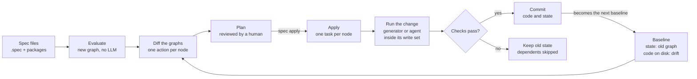

# Spec language: design draft v0

Exported on 2026-11-18 from the Claude Doc "Spec language: design draft v0".
This file is now the working copy. Known weaknesses are listed in `REVIEW.md`.

## Summary

This draft proposes a small declarative language whose programs evaluate to a **spec graph**: typed nodes (pages, entities, actions, rules) joined by references. A CLI diffs that graph against recorded state and the code on disk, prints a reviewable plan, and hands each planned change to an agent as a scoped work order.

Working names: files end in `.spec`, the CLI is `spec` (`spec plan`, `spec apply`). Every decision below is a first position, open to change.

| Decision | Choice in this draft | Why |
| --- | --- | --- |
| Syntax | Own declarative syntax that compiles to a JSON graph | A plan must be computable without running arbitrary code. A TypeScript SDK can target the same graph later. |
| Identity | Every node has a symbolic name; its address is module path + kind + name | Changing a route or a prompt becomes an update, not delete-and-recreate. |
| Status of code | Code is committed and is an input to every change | LLM output is not reproducible, so updates edit the baseline instead of regenerating it. |
| Modules | A directory is a module; context inherits project → module → node | Splitting files needs no ceremony, and module boundaries bound what an agent reads. |
| Framework constructs | Kinds such as `nextjs.page` come from packages, not the core | The core stays small. Packages carry skills, path conventions and checks. |
| State | One record per node, committed to git beside the code | Each branch carries its own baseline, with fewer merge conflicts than one state file. |
| Trust | Every acceptance criterion records how it was verified | "Applied" means checks passed, not that the agent said it finished. |

## Goals and non-goals

The language exists so a human reviews changes to intent (pages, entities, rules) and an agent works out the code.

Goals:

- **Deterministic evaluation.** The same files always produce the same graph. No LLM runs before `apply`.
- **Incremental change.** One edited node produces one scoped task, not a rebuild.
- **Brownfield first.** Existing code can be adopted piece by piece, and hand-written parts stay hand-written.
- **Deterministic tools before agents.** Where a migration generator or a codemod can make a change, the plan uses it and skips the LLM.
- **Visible trust.** Every requirement shows whether it was tested, statically checked, judged by a reviewer agent, or not verified.

Non-goals:

- **A general-purpose language.** No loops, I/O or user-defined functions in v0.
- **Replacing code.** Implementation detail stays in code. The spec says what and why.
- **Reproducible builds from the spec alone.** Regenerating from scratch gives different code each time, so state and baseline code are part of the system.
- **Formal verification.** Prose is first-class and partly unverifiable. The design exposes that instead of hiding it.

## Core model: the spec graph

A project evaluates to a graph where each node is one declared piece of software and each edge is a reference between two nodes. Everything else (diff, plan, agent context, verification) is computed from that graph.

**Node anatomy.** Every node, whatever its kind, has four layers:

| Layer | Example | Checked by the compiler? |
| --- | --- | --- |
| Structure: typed fields defined by the node's kind | `route: "/login"`, an entity's fields | Yes |
| References: edges to other nodes | `uses: [ui.input]`, `@{dashboard.home}` inside prose | Yes, a dangling reference is a compile error |
| Intent: free prose | `prompt: """..."""` | No, the agent reads it |
| Acceptance: `expect` lines | "invalid credentials show one generic error" | After apply, by tests or checks |

The guiding rule: move information up this table whenever possible. Structure and references can be diffed and propagated exactly. A prose change can only be handed to an agent.

**Identity.** A node's address is its module path plus its name, for example `auth.login`. Names are unique within a module across all kinds. The address is what state records are keyed by, so it must survive edits to any field.

**Renames.** A top-level `moved auth.login -> auth.sign_in` statement carries state across a rename. Without it, a rename plans as delete plus create.

**Two hashes per node.** The *interface hash* covers what other nodes can depend on: an entity's fields, a page's route, an action's signature. The *body hash* covers the rest: prompt, expectations, hints. Dependents are re-checked only when an interface hash changes, the same idea as incremental compilation.

## Surface syntax

The language has three statement forms: project statements, imports, and declarations of the shape `<kind> <name> { fields }`.

```
// 1. Project statements (root file only)
stack {
  language: "typescript"
  runtime: "nodejs"
  framework: "nextjs"
  package_manager: "pnpm"
}
use "better-auth" for authentication
use "drizzle" for database
use "ui-sdk" for ui

// 2. Imports
import nextjs
import dashboard

// 3. Declarations
nextjs.page login {
  route: "/login"
  summary: "A page where you can sign in"
  uses: [ui.input, ui.button]
  skills: [authentication.skills]
  prompt: """
    Email and password form. On success go to @{dashboard.home}.
  """
  expect: [
    "valid credentials redirect to @{dashboard.home}",
    "invalid credentials show one generic error",
  ]
}
```

Changes from the original sketch, and why:

- **`nextjs.page("/login", {...})` becomes `nextjs.page login { route: "/login" }`.** A call has no stable identity. If the route were the identity, changing it would delete and recreate the page.
- **`tech_stack "typescript", "nodejs", ...` becomes `stack { ... }` with named slots.** A flat list does not say which entry is the framework. Slots let packages check compatibility.
- **`use "better-auth" for "authentication"` keeps its shape, but the role becomes an identifier: a capability.** Nodes write `authentication.session` or `authentication.skills` without naming the library. Swapping the library is then a one-line change whose blast radius the planner can compute. Free-text roles stay legal for the long tail: `use "pdf-lib" for "pdf generation"`.
- **Backtick prose becomes triple-quoted strings.** Prompts often contain Markdown backticks.
- **`@{ref}` inside prose is new.** A mention becomes a real edge, checked at compile time and followed during planning.

**Values.** Strings, numbers, booleans, lists, records, references, and type expressions such as `string?`, `uuid` or `"draft" | "sent"`. `let` binds constants.

**Deliberately absent in v0.** Loops, conditionals, functions, I/O and environment access. Evaluation always terminates and depends only on the files. Reuse arrives in v1 as `template`: a parameterised group of declarations, such as CRUD pages for an entity, expanded at compile time so each resulting node has a stable address.

**The TypeScript alternative.** Embedding the language in TypeScript, as Pulumi does, gives types and editor tooling for free. It also allows arbitrary code, so identity and determinism would rest on convention. Both frontends would emit the same graph JSON, so this choice is cheap to revisit.

## Projects, files and modules

A directory is a module: every `.spec` file in it shares one namespace, and subdirectories are submodules.

```
acme/
  spec/
    app.spec            project, stack, use, project-wide rules
    core/
      workspace.spec    entities shared across features
    auth/
      module.spec       module header: summary, shared prompt, skills
      login.spec
      signup.spec
    dashboard/
      home.spec
  spec.lock             resolved package versions and content hashes
  .spec/state/          one JSON record per node, committed
  src/                  generated and hand-written code
```

- **File boundaries carry no meaning.** Moving a declaration between files in one directory changes nothing in the graph. Split files by size and by reviewer.
- **Imports.** `import auth` brings in a local module by its path from `spec/`. `import nextjs` brings in a package. A name that matches both is a compile error. Capabilities bound with `use` (`ui`, `authentication`) are in scope everywhere.
- **Visibility is context budgeting.** Declarations are private to their module unless marked `export`. An agent working in `auth` receives `auth` in full and only the exported interfaces of imported modules.
- **Reference cycles are legal.** Two pages may link to each other. Only data and call dependencies order a plan, and those must be acyclic.
- **The spec tree follows features, not code layout.** The package behind each kind decides where code lands, and state records the mapping.

**Inherited context.** Prompts, skills and rules flow project → module → node. A module sets its share in a header:

```
module auth {
  summary: "Sign-in, sign-up and session handling"
  prompt: """
    All auth screens use one centered card layout.
    Never reveal whether an email address is registered.
  """
  skills: [authentication.skills]
}
```

Editing inherited context plans every node beneath it as `verify`, not `update`. The agent checks whether existing code still conforms and edits only where it does not. Without that distinction, one edit to the project prompt would regenerate the whole application.

## Definition kinds

v0 needs twelve kinds: nine in the core and three from packages. Two more can wait.

| Kind | Defines | Key fields | From | In v0 |
| --- | --- | --- | --- | --- |
| `project` | Name and project-wide context | summary, prompt | core | Yes |
| `stack` | Language, runtime, framework, package manager | four named slots with version ranges | core | Yes |
| `use ... for` | A library bound to a capability | package, capability, options | core | Yes |
| `module` | Header for a directory | summary, prompt, skills | core | Yes |
| `entity` | A persisted data type | typed fields, relations, constraints | core | Yes |
| `type`, `enum` | Shared value types | fields or variants | core | Yes |
| `action` | One unit of server-side behaviour, independent of transport | input, output, errors, requires, reads, writes | core | Yes |
| `rule` | A cross-cutting constraint | applies_to, require, check | core | Yes |
| `extern` | Existing code the spec references but does not manage | source path and symbol, summary | core | Yes |
| `nextjs.page` | A routed screen | route, uses, calls, reads, requires | package | Yes |
| `nextjs.endpoint` | An HTTP route | method, path, calls | package | Yes |
| `ui.component` | A project-defined UI component | props, variants, uses | package | Yes |
| `flow` | A user journey across pages, the source of end-to-end tests | steps | core | Later |
| `job`, `event` | Background work, schedules, webhooks | trigger, calls | package | Later |

**Fields every node accepts.** `summary` (one line, shown in plans and passed to dependents), `prompt` (requirements in prose), `hint` (implementation guidance with no test obligation), `uses`, `skills`, `expect`, `depends_on` and `lifecycle`.

```
export entity Workspace {
  id: uuid @id
  name: string @max(80)
  slug: string @unique
  owner: ref authentication.User
  plan: "free" | "team" = "free"
  created_at: timestamp @default(now)
}

action create_workspace {
  input: { name: string }
  output: Workspace
  errors: [NameTaken, LimitReached]
  requires: [authentication.session]
  writes: [Workspace]
  prompt: """
    Derive the slug from the name. Free plans are limited to one workspace.
  """
}

rule app_requires_session {
  applies_to: nextjs.page where route matches "/app/**"
  require: "unauthenticated visitors are redirected to @{auth.login}"
  check: tested
}

extern ui.component LegacyChart {
  source: "src/components/legacy-chart.tsx#LegacyChart"
  summary: "D3 chart kept from the old dashboard"
}
```

**Why `action` is its own kind.** Business behaviour is declared once, and a page and an endpoint can both call it. A change to its signature then propagates to every caller through the graph.

**Entities are special.** A field change implies a database migration, so the planner classifies each one as additive, destructive or needing a backfill. Destructive changes require an explicit flag on `apply`.

**Rules attach by selector.** A rule becomes an edge to every node its `applies_to` matches, including nodes added later. Its `check` field states the required level of verification.

## Packages and providers

A package is what gives `nextjs.page` or `ui.input` a meaning. It ships five things:

| A package ships | Example | Used for |
| --- | --- | --- |
| Kinds: field schemas for declarations | `nextjs.page` with `route`, `rendering`, `layout` | Compile-time checking |
| Catalog nodes: ready-made things to reference | `ui.input`, `ui.button`, `authentication.User` | `uses` lists and entity references |
| Skills: instruction folders for agents | `authentication.skills` | Injected into the agent's work order |
| Output conventions: where code for a kind lives | a page with route `/login` → `src/app/login/page.tsx` | Ownership and drift detection |
| Checks and generators | typecheck, build, `drizzle-kit generate` | Verification and deterministic steps |

A kind is declared in the package's own `.spec` files:

```
export kind page {
  route: route_path                          @interface
  rendering: "static" | "server" | "client" = "server"
  layout: ref layout?
  uses: [ref ui.component]
  calls: [ref action]
  outputs: "src/app/${route}/page.tsx"
  checks: [typecheck, build]
}
```

`@interface` marks the fields that feed the interface hash.

The package holds no code generator for pages. The agent writes the page; the package only says what a page is, where it lives and how to verify it.

**Capabilities.** A capability is an interface a package declares it implements. `better-auth` implements `authentication` by exporting `User`, `session` and `skills`. Swapping in another implementation plans as `verify` or `update` on every node that references the capability.

**Generators.** A package may register a deterministic generator for a class of change. Drizzle can turn an entity diff into schema and migration files with no LLM. A field rename can run as a codemod over the regions that reference it. The planner picks a generator over an agent whenever one matches.

**Distribution.** A package is an npm package holding `.spec` files and skill folders. `spec.lock` pins each version and content hash. Skill hashes feed each node's context hash, so a package upgrade appears in the plan as `verify` on the nodes that use it.

**Bootstrapping.** Someone has to write these packages. v0 can ship one hand-written `nextjs` package and treat every other library as a free-text `use`, with its documentation fetched as a skill.

## State, plan and apply

`spec plan` compares three things: the new graph, the recorded state, and the code on disk. It emits one action per affected node. `spec apply` runs each action as a scoped task and advances state only for nodes whose checks pass.



Everything up to the plan is deterministic. An LLM first runs inside apply, and a node that fails its checks keeps its previous state.

**State record.** One file per node, for example `.spec/state/auth.login.json`:

```
{
  "address": "auth.login",
  "kind": "nextjs.page",
  "interface_hash": "9c1e...",
  "body_hash": "41af...",
  "context_hash": "d07b...",
  "depends_on": { "dashboard.home": "77e2..." },
  "applied_spec": "<normalized text of the node as last applied>",
  "outputs": [
    { "path": "src/app/login/page.tsx", "region": "file", "hash": "be90..." },
    { "path": "tests/auth/login.test.ts", "region": "file", "hash": "13c4..." }
  ],
  "expect": [
    { "id": "e1", "status": "tested", "by": "tests/auth/login.test.ts#redirects" }
  ],
  "provenance": { "model": "...", "lock": "5f3a...", "applied_at": "2026-11-18" }
}
```

`context_hash` covers inherited prompts, rules, and skill and package versions. `depends_on` stores the interface hashes seen at the last apply. `applied_spec` lets the plan show a text diff of intent.

State is committed in the same commit as the spec and code it describes. Each branch then carries a consistent triple, git history is the audit log, and no remote backend is needed.

**Plan algorithm.**

1. Evaluate the spec files to a new graph. No LLM runs.
2. Load the state records as the old graph.
3. Refresh: hash every owned output on disk and compare with state to find drift.
4. Diff the graphs by address and classify each node with an action from the table below.
5. Propagate: for every node whose interface hash changed, mark its dependents `verify`.
6. Order by dependency into waves. Nodes in one wave have disjoint write sets and can run in parallel.
7. Print the plan and write `plan.json`.

| Action | Trigger | What runs |
| --- | --- | --- |
| `create` | The address is new | An agent writes new code from the spec |
| `update` | Body or interface hash changed | An agent edits existing code, given old spec, new spec and current files |
| `verify` | Only context or a dependency's interface changed | Checks confirm conformance; an agent edits only if they fail |
| `replace` | Requested with `--replace`, or the node's kind changed | Old outputs are deleted and the code is regenerated |
| `delete` | The address is gone | Owned outputs are removed and references cleaned up |
| `move` | A `moved` statement | State is re-keyed; files are renamed if conventions require |
| `resolve` | Drift detected | A human chooses adopt, absorb or overwrite |

**Update is an edit, not a regeneration.** The agent receives a spec diff ("prompt: +2 lines; uses: + ui.link") plus the current code, and is asked for the smallest change. This contains non-determinism: nodes that did not change are never re-rolled.

**Work order.** Each plan step becomes a self-contained task:

```
{
  "node": "auth.login",
  "action": "update",
  "spec_diff": "...",
  "write_set": ["src/app/login/page.tsx", "tests/auth/login.test.ts"],
  "read_context": ["auth (module, full)", "dashboard.home (interface)", "ui.link (catalog)"],
  "skills": ["authentication.skills"],
  "must_pass": ["typecheck", "build", "expect:e1", "expect:e2", "expect:e4"]
}
```

Writes outside `write_set` are rejected unless the agent declares a new file, which the node then owns.

**Apply semantics.** Each node is its own transaction. State advances only when `must_pass` succeeds. A failed node keeps its old state, and later waves that depend on it are skipped. Running `plan` again picks up the remainder.

## Agent interface

This section was discussed after the first draft and is not yet in the Claude Doc.

Agents never interpret the spec tree themselves. The `spec` CLI is the orchestrator: it compiles, diffs and decides what must change, then hands each change to an agent as a self-contained work order. The agent's only job is to make the code in a bounded set of files satisfy one node.

**Life of one task.**

1. The CLI builds a work order per plan step. It contains the node's new spec text and the diff from the last applied version, the inherited project and module prompts, the interfaces (not the code) of the nodes it references, the skill folders named in `skills`, the write set, and the checks that must pass.
2. Any coding agent runs it headless, in its own git worktree. The work order is rendered as the prompt, so the runtime is pluggable.
3. The agent edits and self-checks, then writes a small result file: the files it touched, which test covers which `expect` id, and any new files it wants the node to own.
4. The CLI verifies independently. It diffs the worktree, rejects writes outside the write set, and reruns the checks itself instead of trusting the agent's report.
5. On a pass, the CLI updates state and commits. On a failure, it feeds the errors back for a bounded number of retries, then marks the node failed.

Nodes in the same wave have disjoint write sets, so they run in parallel worktrees and merge without conflicts.

**Integration surfaces.**

- **Subprocess.** The minimum. `spec apply --agent "<command>"` pipes in the work order and reads the result file.
- **MCP server.** The CLI exposes tools so the agent can pull context on demand: look up a referenced node's interface, request an extension to its write set, report test-to-`expect` mappings, and return "blocked" with a question when the spec is ambiguous or contradictory.
- **Skills.** Packages ship them as ordinary instruction folders. `skills: [authentication.skills]` means "mount this folder for this task."

**Agents editing specs.** When a developer asks an agent in the repo to "add forgot password", the agent should edit the `.spec` file, run `spec plan`, show the plan, then run `spec apply`. A repo instruction file tells agents that owned files change only through the spec, and a pre-edit hook (where the runtime supports one) blocks or flags direct edits to owned files. `absorb` and `spec import` run the other way: an agent reads code and proposes a spec patch for a human to review.

**What the agent is not trusted with.** It does not choose its scope, declare itself done, or touch state. Those stay with the CLI.

## Drift, hand-written code and shared files

Code may be edited by hand. The planner detects the edit and asks a human what it means.

Drift is an owned output whose hash on disk differs from state. It has three resolutions:

| Resolution | Meaning | Effect |
| --- | --- | --- |
| `adopt` | The edit is fine and the spec still describes the code | State hash is updated; the spec is untouched |
| `absorb` | The edit changed behaviour the spec should capture | An agent proposes a spec patch, reviewed like any spec change |
| `overwrite` | The edit was a mistake | The node is planned as `update` back to the spec |

`absorb` is the code-to-spec direction. It keeps the spec honest without forbidding the hand edits any team makes during an incident.

**Lifecycle.** Every node has a `lifecycle` field:

- `managed` (default): agents may edit the node's outputs.
- `frozen`: the spec documents the code, agents never write to it, and drift is ignored. For hand-tuned or sensitive code.
- `protected`: outputs are never deleted, even if the node leaves the spec.

**Existing codebases.** `spec import src/app/login/page.tsx` drafts a node from existing code and records it in state without changing the code. `extern` is the lighter option: reference a symbol without managing it.

**Ownership granularity.** v0 owns whole files. The next step is ownership by symbol through AST anchors, so two nodes can share a file. Hashing a normalized AST instead of bytes also stops formatter runs from registering as drift.

**Shared files are the hard case.** `package.json`, a navigation component, middleware and a schema index are each touched by many nodes. The proposal is owner plus contributions: one node owns the file, and other nodes declare typed contributions to it.

```
nextjs.page login {
  route: "/login"
  contributes: [nav.item { label: "Sign in", to: @{login}, when: "signed out" }]
}
```

When the set of contributions changes, the owner is planned as `update`. The dependency manifest is the simplest instance: the project node owns it and derives it from `stack` and `use`.

## Verification

A node counts as applied only when its checks pass, and each `expect` line records how it was verified.

| Level | Catches | Supplied by | Deterministic |
| --- | --- | --- | --- |
| 1. Compile | Dangling references, type errors in the spec, selectors that match nothing | The language | Yes |
| 2. Conformance | Code that departs from declared structure: wrong path for the route, imports outside `uses`, columns that differ from entity fields | The package, as AST checks | Yes |
| 3. Build | Type errors, lint failures, a broken build | The package | Yes |
| 4. Behaviour | An `expect` line with no passing test mapped to it | An agent writes the test; the runner executes it | The run is; test quality is not |
| 5. Review | Prose requirements no test can cover, such as tone of copy | A separate agent that did not write the code | No |

**Statuses.** Each `expect` ends as `tested`, `checked`, `judged` or `unverified`. The apply summary prints the counts, for example "14 tested, 3 checked, 2 judged, 1 unverified". A rule or project setting can set a floor: `check: tested` fails the apply if a requirement only reached `judged`.

**Level 2 makes `uses` binding.** An agent that reaches for an undeclared library fails conformance. The `uses` list is enforced, not advisory.

**Level 4 is the weak point.** If one agent writes both the code and its test, the test can pass trivially. Two mitigations: a separate agent writes the test from the `expect` text before implementation starts, and critical nodes get a mutation check, where the behaviour is broken on purpose and the test must fail.

## Worked example

A project with three feature modules, then the plan for one change: adding a forgot-password page.

`spec/app.spec`

```
import nextjs
import auth

project acme_web {
  summary: "Customer portal for Acme"
  prompt: """
    Server-render by default. All copy in plain English, sentence case.
  """
}

stack {
  language: "typescript"
  runtime: "nodejs@22"
  framework: "nextjs@15"
  package_manager: "pnpm"
}

use "better-auth" for authentication
use "drizzle" for database { dialect: "postgres" }
use "ui-sdk" for ui

rule app_requires_session {
  applies_to: nextjs.page where route matches "/app/**"
  require: "unauthenticated visitors are redirected to @{auth.login}"
  check: tested
}
```

`spec/core/workspace.spec`

```
export entity Workspace {
  id: uuid @id
  name: string @max(80)
  slug: string @unique
  owner: ref authentication.User
  created_at: timestamp @default(now)
}
```

`spec/auth/login.spec` (the module header from the modules section sits beside it in `module.spec`)

```
import nextjs
import dashboard

export nextjs.page login {
  route: "/login"
  summary: "A page where you can sign in"
  uses: [ui.form, ui.input, ui.button]
  calls: [sign_in]
  prompt: """
    Email and password form in the shared auth card.
    On success go to @{dashboard.home}.
  """
  expect: [
    "valid credentials redirect to @{dashboard.home}",
    "invalid credentials show one generic error and keep the email filled in",
    "the submit button is disabled while the request is in flight",
  ]
}

action sign_in {
  input: { email: email, password: string }
  output: authentication.session
  errors: [InvalidCredentials, RateLimited]
  hint: "Use the library's email and password flow. Do not hand-roll hashing."
}
```

`spec/dashboard/home.spec`

```
import nextjs
import core

export nextjs.page home {
  route: "/app"
  summary: "Lists the signed-in user's workspaces"
  requires: [authentication.session]
  reads: [core.Workspace]
  uses: [ui.card, ui.button]
  prompt: """
    One card per workspace, newest first.
    The empty state offers "Create workspace".
  """
}
```

**The change.** Add `spec/auth/forgot_password.spec` with a page and an action, add one prompt line and `ui.link` to `login`, and add `archived_at: timestamp?` to `Workspace`. Meanwhile someone has hand-edited the signup page.

```
$ spec plan

Spec changes (4 nodes)
  + nextjs.page  auth.forgot_password     /forgot-password
  + action       auth.request_reset
  ~ nextjs.page  auth.login
      prompt   +1 line   "Link to @{forgot_password} under the password field."
      uses     + ui.link
      expect   + e4      "the forgot-password link goes to @{forgot_password}"
  ~ entity       core.Workspace
      + field  archived_at: timestamp?
      migration: additive, generated by drizzle (no agent)

Affected through dependencies (1 node)
  ? nextjs.page  dashboard.home           verify: reads core.Workspace

Drift (1 node)
  ! nextjs.page  auth.signup              src/app/signup/page.tsx edited by hand (+14 -3)
      resolve with: adopt | absorb | overwrite

Plan: 2 create, 2 update, 1 verify, 1 to resolve
Waves: [core.Workspace] -> [auth.request_reset, dashboard.home] -> [auth.forgot_password, auth.login]
Agent tasks: 3, plus 1 if verify fails. Generator tasks: 1.
```

What the plan shows:

- The `Workspace` change runs through a generator, with no LLM involved.
- `dashboard.home` is only verified. The new field is additive, so its checks will most likely pass with no edit.
- The signup drift blocks nothing else and is resolved on its own.
- `app_requires_session` does not attach to the new page, because `/forgot-password` is outside `/app/**`.

## Open questions and first milestone

The riskiest assumption is that `update` works as a scoped edit: an agent given a spec diff and its owned files makes a small, correct change and stays inside its write set. The first milestone should test only that.

**First milestone.**

1. A parser and evaluator for `project`, `stack`, `use`, `module`, `nextjs.page` and `action`, emitting graph JSON.
2. State records with whole-file ownership, and `spec plan` with create, update, delete and drift detection. No dependency propagation yet.
3. `spec apply` that turns each step into a work order for one existing coding agent, with typecheck and build as the only checks.
4. A trial on a toy Next.js app: ten spec edits in sequence. Measure first-time pass rate, writes outside the write set, and the size of each code diff relative to its spec diff.

Deferred until that works: entities and migrations, rules, tests from `expect`, contributions, and any package beyond a hard-coded `nextjs`.

**Open questions.**

| Question | Current lean |
| --- | --- |
| Own syntax or a TypeScript frontend first? | Own syntax, for static analysis. Revisit if parser and editor tooling cost dominates. |
| How much belongs in structure versus prose? | Structure for anything another node references. Prose for the rest. |
| How do prompts stay short, so the spec does not become code written in English? | A lint on prompt length, and pressure to move detail into fields, `hint` or skills. |
| Are tests outputs of a node or nodes of their own? | Outputs of the node, each mapped to an `expect` id. |
| What happens when two branches change the same node? | Per-node state files conflict exactly where the code does. After a merge, `plan` re-verifies those nodes. |
| Is the agent runtime pluggable? | Yes. The work order JSON is the contract, and any coding agent can consume it. |
| How are environments and secrets declared? | Out of scope for v0. The spec names required environment variables and nothing more. |
| What is the language called? | Undecided. `spec` is a placeholder. |
