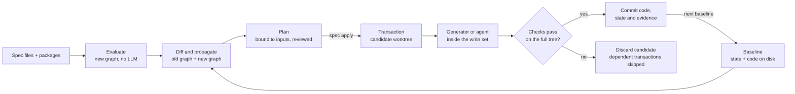

# Spec language: design draft v0.2

Working copy. v0 was exported on 2026-11-18; `REVIEW.md` is the self-review of v0,
`DECISIONS.md` logs every change since, and `rounds/` holds the design rounds.

Contents: Summary · Goals · Core model (declarations, identity, moves, edges, projections,
evidence) · Surface syntax · Projects, files and modules · Definition kinds · Packages ·
State, plan and apply · Agent interface (reference: `PROTOCOL.md`) · Ownership and drift ·
Verification · Runtime state · Worked example · First milestone and open questions.
Grammar: `GRAMMAR.ebnf`. Checker: `tools/check_examples.py`.

## Summary

A small declarative language whose programs evaluate to a **spec graph**: typed
declarations (pages, entities, actions, rules) joined by typed edges. A CLI diffs that
graph against recorded state and the code on disk, prints a reviewable plan, and applies
it as a series of verified transactions, each handed to an agent as a scoped work order.

Working names: files end in `.int`, the CLI is `spec` (`spec plan`, `spec apply`).

| Decision | Choice | Why |
| --- | --- | --- |
| Syntax | Own declarative syntax that lowers to a JSON graph | A plan must be computable without running arbitrary code. Humans review the syntax; tools consume the graph. |
| Identity | Every declaration has an address: module path + name | Changing a route, a prompt or even the kind is an update, not delete-and-recreate. |
| Status of code | Code is committed and is an input to every change | LLM output is not reproducible, so changes edit the baseline instead of regenerating it. |
| Unit of apply | A transaction: one changed declaration plus the dependents it breaks | An interface change and its callers cannot pass checks separately. |
| Modules | A directory is a module; context inherits project → module → declaration | Splitting files needs no ceremony; module boundaries bound what an agent reads. |
| Framework constructs | Kinds such as `nextjs.page` come from packages | The core stays small. |
| State | One record per managed declaration, committed beside the code | Each branch carries its own baseline. |
| Trust | Baseline and evidence are separate; evidence names the tree it ran on | "Applied" means checks passed on this code, not that an agent said so. |

## Goals and non-goals

A human reviews changes to intent; an agent works out the code.

Goals:

- **Deterministic evaluation.** The same files always produce the same graph and plan. No LLM runs before `apply`.
- **Incremental change.** One edited declaration produces one scoped transaction, not a rebuild.
- **Brownfield first.** Existing code is adopted piece by piece; hand-written parts stay hand-written.
- **Deterministic tools before agents.** Where a generator or codemod can make a change, the plan uses it.
- **Visible trust.** Every requirement shows how, and on which tree, it was verified.

Non-goals:

- **A general-purpose language.** No loops, I/O or user-defined functions.
- **Replacing code.** Implementation detail stays in code. The spec says what and why.
- **Reproducible builds from the spec alone.** State and baseline code are part of the system.
- **Formal verification.** Prose is first-class and partly unverifiable; the design exposes that.

## Core model

### Declarations

A project evaluates to a graph of declarations. There are two sorts:

- **Managed declarations** own outputs (files) and have a state record: pages, actions,
  entities, components, endpoints, the `stack` (toolchain files) and any `use` binding
  whose package declares integration files.
- **Context declarations** own nothing and have no state record: `project`, `module`,
  `rule`, `type`, `environment`, `extern`, and `use` bindings without outputs. They feed
  the projections of declarations that reference or inherit them; they have addresses, and
  their effects are recorded in the state of each managed declaration they reach.

Every declaration has four layers. The rule is to move information up the table.

| Layer | Example | Checked |
| --- | --- | --- |
| Structure: typed fields defined by the kind | `route: "/login"`, entity fields | By the compiler |
| References: typed edges | `calls: [sign_in]`, `@{dashboard.home}` in prose | By the compiler; dangling is an error |
| Intent: prose | `prompt: """..."""` | Read by the agent |
| Acceptance: named `expect` members | `redirects: "valid credentials redirect to ..."` | After apply, by evidence (tests, review, checks, approval) |

### Identity

A declaration's **address** is its module path plus its name: `auth.login`,
`core.Workspace`. The kind is not part of the address, so names are unique within a
module across all kinds, and a kind change keeps the address (and plans as `replace`).

**Members.** Anything inside a declaration that state, evidence or a migration tracks has
a member address `decl#collection.key`. Each kind's schema declares its *addressable
collections*; members are always keyed by name, never by position or text hash:

| Collection | Example address | Declared by |
| --- | --- | --- |
| `expect` | `auth.login#expect.redirects` | core, every declaration |
| `errors` | `auth.sign_in#errors.invalid_credentials` | core, `action` |
| `input`, `output` | `auth.sign_in#input.email` | core, `action` |
| `fields` | `core.Workspace#fields.name` | core, `entity` |
| `outputs` | `auth.login#outputs.page` | the kind's package |
| `contributes` | `auth.login#contributes.nav` | the kind's package |

Keys are unique within a collection; `#fields.name` and `#expect.name` are distinct.

**Other identities.** A package catalog symbol is identified by its canonical package and
export path (`npm:ui-sdk::Input`), never by the alias it was imported under, and appears
only in graph JSON and state. A capability is identified by its name; its provider and
options are inputs. An output is identified by its slot (`#outputs.page`); its file path
is a locator that may change, so a route edit moves a file rather than deleting one.
`extern` keeps its address while its `source` locator changes.

### Moves

`moved` asserts that two addresses denote one continuing thing:

```spec
moved auth.login -> auth.sign_in
moved module billing -> payments
moved auth.sign_in#expect.redirects -> auth.sign_in#expect.valid_redirect
moved core.Workspace#fields.name -> core.Workspace#fields.title
```

Moves are resolved into one mapping before the diff. The most specific source wins at
each step, chains are followed to their end, and the mapping must be one-to-one:

| Case | Result |
| --- | --- |
| Rename without `moved` | Delete plus create. The plan may *suggest* a `moved` when bodies are near-identical. |
| `a -> b`, later `b -> c` | Both `a` and `b` resolve to `c`. |
| `a -> b` and `b -> a` | Compile error. |
| Two baseline objects reach one target | Compile error: moves cannot merge. |
| Source and target both have state | Collision error; target state is never overwritten. |
| Source absent from this baseline | No-op here, reported as such. |
| Source and target in different collections | Compile error: an expectation cannot become a field. |
| A new declaration reuses a moved-away source address | Compile error while the `moved` statement exists. |

A move preserves history; it does not make the change free. Renaming an entity field is a
semantic `rename_field`, which the database package lowers to a column rename (or to
nothing, if the column name is pinned). If it cannot preserve data, the plan fails rather
than falling back to drop-and-add. Moving an expectation to another declaration carries
its test binding but requires its coverage to be reassessed, and both declarations join one
transaction. Splitting or merging members needs an explicit change, not several moves.

`moved` statements stay in the spec indefinitely. A local planner cannot know which
branches still hold old state, so it never reports a move as safe to delete.

**Branch merges.** After a merge, `spec plan` reconciles identity three-way against the
merge base: it applies one branch's edits through the other branch's moves, reports two
different destinations for one source as an identity conflict, and reports two state
records claiming one output as an ownership conflict.

### Edges and relations

Every edge has a **relation**, fixed by the kind field it comes from. A relation states
what it **consumes** and **observes** from the target (see Propagation), whether it
**orders** work, and what **imports** it grants to the source's code.

| Relation | Comes from | Consumes | Observes | Orders | Grants imports |
| --- | --- | --- | --- | --- | --- |
| `calls` | `calls` | public projection | behaviour | yes | the target kind's `exports` |
| `reads`, `writes` | `reads`, `writes` | entity read or write contract | behaviour | yes | the entity's data-access exports |
| `uses` | `uses` | component or catalog contract | none | yes | target's runtime exports |
| `types` | a type position, e.g. `output: Workspace` | type shape | none | yes | type-only imports |
| `requires` | `requires` | capability contract | none | no | bound package's runtime exports |
| `mentions` | `@{...}` in prose or `expect` | public projection | none | no | none |

Relations are fixed by the core in v0; package kinds attach them to fields with
`@relation`. Reference cycles are legal; only cycles among changes that must be made
jointly merge (see Transactions).

### Projections and hashes

Hashes are computed over canonical projections of the graph, never over source text. A
frontend emits the graph as JSON (`schemas/graph.schema.json`) with every name resolved,
member short forms expanded, defaults filled and matching rules listed per declaration
(`applies`). A projection's hash is the sha256 of its canonical JSON: sorted keys, no
insignificant whitespace, UTF-8, every string and key NFC-normalised, integers without
exponent, an integral float written as an integer, other numbers in shortest round-trip
form, non-finite numbers rejected; arrays that are sets (edges, `uses`, `calls`,
`reads`, `applies`) sorted by the canonical JSON of their elements, other arrays in authored
order; prose dedented, with LF line ends, trailing spaces removed and mentions rewritten to
`@{<address>}`. Source locations are diagnostics and never hashed. An action's `input` and
`output` are record-type field values; their keys are also the members `input.<key>` and
`output.<key>`.

The worked example below exists as complete graphs (`examples/graph.before.json`,
`examples/graph.after.json`). `tools/canon.py` is a reference canonicaliser: it computes
every declaration's projection hashes (`examples/hashes.json`), passes the canonical-JSON
test vectors in `examples/hash-vectors.json` (including NFC-equivalent strings), and
derives the change set
of the plan, and the checker confirms that `examples/plan.json` (schema
`schemas/plan.schema.json`) agrees with it.

| Projection | Covers | Invalidates |
| --- | --- | --- |
| `public` | `summary` plus `@interface` fields (a route, an action signature, entity fields), with type references resolved to their own public projections | Dependents that consume it |
| `behaviour` | The declaration's own normative prose: `prompt`, `expect` and `errors` text | The declaration; dependents that observe it |
| `body` | Everything else the declaration states except guidance: `uses`, non-interface kind fields | The declaration itself |
| `guidance` | `hint` and `skills` | Nothing: guidance shapes future work only, so a change creates no obligation |

Which fields are `@interface` comes from the kind: package kinds mark them, and core kinds
fix them (`action`: `input`, `output` and error codes; `entity`: its `fields` members;
`stack` and `use`: all their fields; `rule`: `applies_to`). Inherited normative context is
kept out of `behaviour` on purpose: an edit the author made to this declaration and an edit
made to a module above it have different consequences (see Propagation).
| `context` | Inherited normative context (project prompt, module prompt, matching rules' prompts and expectations), inherited hints, and package components (skills, output conventions, checks, generators), each hashed separately | The declaration, as classified under Propagation; dependents that observe it |

A type reference inside a public projection is replaced by the referenced type's address
and public hash, so changing a shared `type` changes the public projection of every action
whose signature mentions it, and so reaches their callers. Mutually recursive types are
hashed together: the strongly connected component's members, sorted by address, form one
hash input, and each member's hash is that component hash plus its own address.
`extern` declarations record a hash of the source symbol they point to, so editing that
code changes their public projection.

State stores, for each outgoing edge, the hash of the projection consumed at the last
apply. Planning compares these, so a dependent is invalidated exactly when what it
consumed changed.

### Evidence

The **baseline** is the set of output digests a human or a passing transaction accepted.
**Evidence** is separate: a record of what was checked, by whom, on which inputs, for which
revision of a requirement (see Verification). Adopting a hand edit renews the baseline, never
the evidence. The subject of evidence is a pair, so a rule's requirement applied to a page
fits the same model:
`{ "target": "dashboard.home", "requirement": "app_requires_session#expect.redirects" }`.

## Surface syntax

The normative grammar is `GRAMMAR.ebnf`; `tools/check_examples.py` parses every `spec`
block in this document against it. This section explains the choices.

**Own syntax, no TypeScript frontend in v0.** Identity, edges, attachment and visibility all
need a compiler whatever the spelling, so TypeScript would save the parser and little else.
A credible embedding would be either a restricted, statically interpreted subset (another
language with its own diagnostics) or an evaluated builder (which breaks the promise that
planning runs no authored code, and makes reviewers read the computation instead of the
change). The tooling plan is deliberately small: one parser with source spans and
preserved comments serving compiler, diagnostics and formatter; syntax highlighting; a
formatter that never rewrites prose; then a thin language server (diagnostics, completion,
hover, go to definition, references) on the compiler's resolver, with rename deferred until
it can emit the `moved` statements a rename needs. A TypeScript frontend can come later if
the milestone shows demand; it would lower to the same graph and pass the same fixtures.

```spec
// Root module only: project, stack, use
project acme_web {
  summary: "Customer portal for Acme"
}

stack {
  language: { name: "typescript" }
  runtime: { name: "nodejs", version: "22" }
  framework: { name: "nextjs", version: "^15.0.0" }
  package_manager: { name: "pnpm" }
}

use "better-auth" for authentication
use "drizzle" for database { dialect: "postgres" }
use "ui-sdk" for ui

// Any module: imports and declarations
import nextjs
import dashboard

export nextjs.page login {
  route: "/login"
  summary: "A page where you can sign in"
  uses: [ui.input, ui.button]
  prompt: """
    Email and password form. On success go to @{dashboard.home}.
  """
  expect {
    redirects: "valid credentials redirect to @{dashboard.home}"
    generic_error: "invalid credentials show one generic error"
  }
}
```

### Statements

| Form | Example | Where |
| --- | --- | --- |
| `project <name> { }` | `project acme_web { summary: "..." }` | Root module, once |
| `stack { }` | named tool slots, each `{ name, version? }` | Root module, once |
| `use "<package>" for <capability> { options }?` | `use "drizzle" for database { dialect: "postgres" }` | Root module |
| `module { }` | the directory's header: summary, prompt, skills | Once per directory |
| `import <path> (as <alias>)?` | `import nextjs`, `import module auth as auth_pages`, `import package "@acme/ui" as acme_ui` | Any module |
| `<kind> <name> @annotation* { }` | `nextjs.page login { ... }` | Any module |
| `extern <kind> <name> { }` | existing code, referenced but unmanaged | Any module |
| `type <name> = <type>` | `type Plan = "free" \| "team"` | Any module |
| `let <name> = <expr>` | `let max_name = 80` | Any module |
| `moved <address> -> <address>` | `moved auth.login -> auth.sign_in` | Any module |
| `environment <name> { }` | a deployment target to observe (see Runtime state) | Root module |
| `kind`, `implements`, `annotation`, `check`, `generator`, `observer`, `binding` | definitions | Package sources only |

`export` may precede `type`, `let` and declarations. Bodies hold **fields** (`name: expr`)
and **sections** (`name { ... }`); which fields and sections are legal is fixed by the
kind's schema. A declaration's own metadata (`summary`, `prompt`, `lifecycle`) and its
user-defined schema never share a namespace: an entity's persisted fields live in a
`fields { }` section, so an entity may have a column called `summary`.

**Separators.** Inside `{ }`, `[ ]` and `( )` items are separated by a comma or a line
break, and a trailing separator is allowed. Top-level statements are separated by line
breaks. Line breaks are tokens, never inferred: an expression may continue onto the next
line only after an opener, a comma, `:`, `=`, `|`, `where`, `and`, `or`, `not` or a
comparison operator. Comments run from `//` to the end of the line.

**Strings.** `"line strings"` take backslash escapes (`\"`, `\\`, `\n`, `\t`, `\u{...}`).
`"""prose strings"""` take none except `\"""`; a prose string that starts with a line
break is a block, dedented by the indentation of its least-indented line, with its closing
`"""` on a line of its own. In both, `@{path}` is a mention (a `mentions` edge) and
`@@{` is a literal `@{`. A lone `@`, an email address or a backtick is just text.
`${field}` interpolation exists only in `template`-typed fields of kind definitions.

**Keywords** are reserved only where a name is being bound or a path starts. Any word,
`type` included, can be a field name, section name, record key or path segment after a dot.

**Named members.** Addressable collections (`expect`, `errors`, entity `fields`) are
sections whose keys are identities. Each member takes a short form, a string for the
collection's primary text field, or a long form with more fields:

```spec
action create_workspace {
  errors {
    name_taken: "The workspace name is already in use"
    limit_reached {
      summary: "Free plans allow one workspace"
      code: "PLAN_LIMIT"
    }
  }
  expect {
    slug_unique: "two workspaces never share a slug"
    free_limit {
      text: "a free user's second workspace fails with limit_reached"
      verify: "tested"
    }
  }
}
```

Both forms lower to the same canonical member, so switching between them changes no hash.
An error's wire `code` defaults to its key; renaming the key with `moved` changes the
public contract unless the destination pins `code` to the old value.

### Values and types

There is one expression grammar. The field's schema says whether an expression is read
as a value or as a type:

| Expression | As a value | As a type |
| --- | --- | --- |
| `"free"` | string | the singleton type `"free"` |
| `42`, `true`, `null` | number, boolean, null | singleton types |
| `[T]` | one-element list | list of `T` |
| `{ name: string }` | record | structural record type |
| `A \| B` | error | union |
| `T?` | error | optional: `T` or `null`, and omittable as a record field |
| `ref T` | error | reference to a managed declaration, e.g. an entity foreign key |
| `path` | reference to a declaration or constant | named type |
| `path { ... }` | constructor record: a contribution to the owner declaration `path`, or a value of catalog type `path` | error |
| `self` | the enclosing declaration | error |

Defaults (`= expr`) and field annotations are legal only where a record describes a schema:
entity `fields`, `input`, `output`, kind `fields` and annotation `parameters`. Declaration
annotations go after a declaration's name. Defaults apply when a field is omitted,
not when it is `null`. `now` is a symbolic initializer meaning "at creation time"; the
compiler never reads the clock. Enum-like values are string literals (`verify: "tested"`,
`lifecycle: "frozen"`), and enumerations are unions: `type Plan = "free" | "team"`.

### Scoping and resolution

All files in a directory form one module with one binding table:

- local declarations, types and lets;
- import aliases (imports belong to the module, not the file; identical repeated imports
  coalesce);
- capability names bound by `use` anywhere in the project;
- the core prelude: core kinds, builtin types, `now`, core annotations.

Any two bindings with the same name are a compile error, whatever their sorts: a module
imported as `auth` and a capability called `auth` collide, and the fix is an alias
(`import module auth as auth_pages`). Nothing shadows anything. Imports and lets do not
flow into child modules, and child modules need an import like any other.

`import x` succeeds only if exactly one local module or package is called `x`; otherwise
write `import module x` or `import package "x" as y`.

A path `a.b.c` resolves as follows:

1. Look up `a` in the binding table. Absent is an error.
2. Walk each further segment through what the previous one denoted: a module (its exported
   declarations, lets and child modules), a package or capability (its exported catalog
   declarations), or a constant record (its keys). Anything else, including a
   declaration, is an error: declarations are not records, so `login.route` is illegal.
3. Check visibility when the walk leaves the current module: only `export`ed names.
4. Check the result against the field's schema. There is no fallback to another reading.

Mentions in strings use the same resolver. `self` names the enclosing declaration.
`moved` takes canonical addresses, which are not resolved through bindings, so the old
address may no longer exist. Forward references and reference cycles are legal. A `type`
may refer to itself through a record field, a list element or a `ref` (structural
recursion: `type Tree = { label: string, children: [Tree] }`); a cycle that passes through
none of these is an alias cycle and an error (`type A = B` with `type B = A`, or
`type Name = Name | string`). `let` cycles are always errors. Mutually recursive types are
hashed together (see Projections and hashes).

A capability bound to a library with no spec package exposes only its own name:
`uses: [pdf]` grants imports of that library and nothing more.

### Annotations

An annotation is `@name` or `@name(args)` after a field, or after a declaration's name.
Each annotation is a declaration with a definition, never free-form metadata:

```spec
export annotation index {
  targets: ["entity_field"]
  projection: "public"
  repeatable: false
  parameters {
    method: "btree" | "hash" = "btree"
  }
}
```

A definition has `targets` (any of `entity_field`, `schema_field`, `kind_field`,
`declaration`), `projection` (`public`, `body` or `guidance`: where an application is
hashed), `repeatable` (default `false`) and an ordered `parameters` schema matched
positionally. The compiler resolves the name like any path (`@database.index("hash")`),
checks the target, the field type and the arguments, and rejects repeats unless allowed. Packages export annotations; their meaning is
consumed by the package's own checks and generators, never invented by the compiler.

Core annotations:

| Annotation | On | Meaning |
| --- | --- | --- |
| `@id` | entity field | Identity field; one non-optional scalar |
| `@unique` | entity field | Uniqueness constraint |
| `@max_length(n)` | string field | Length limit |
| `@interface` | kind field | The field joins the public projection |
| `@relation("name")` | kind field | The relation of edges from this field (see Edges and relations) |
| `@deprecated("message")` | declaration | Warning on every reference |

### Selectors

Rules select the declarations they apply to:

```spec
rule app_requires_session {
  applies_to: select nextjs.page where route matches "/app/**"
  expect {
    redirects {
      text: "unauthenticated visitors are redirected to @{auth.login}"
      verify: "tested"
    }
  }
}
```

`select` takes `*`, a kind, or a list of kinds, then an optional `where` predicate built
from `and`, `or`, `not`, parentheses and tests. A test is `exists field` or
`field op operand` with `==`, `!=`, `<`, `<=`, `>`, `>=`, `matches`, `in` or `contains`.
A bare name is a field of the candidate; `meta.module`, `meta.name` and `meta.kind` are
its metadata. `matches` is a full-string, case-sensitive glob in which `*` matches within
one path segment and `**` matches zero or more whole segments, so `/app/**` matches `/app`.
`contains` is collection membership, not substring search.

| Operator | Field type | Operand | A missing field |
| --- | --- | --- | --- |
| `==`, `!=` | any scalar, reference, or string-literal union | a literal or path of the same type; `null` | false for both |
| `<`, `<=`, `>`, `>=` | number, integer, date, timestamp | a literal of the same type | false |
| `matches` | string, `route_path` | a string glob | false |
| `in` | any scalar or reference | a list of operands of that type | false |
| `contains` | a list | one element of the list's element type | false |
| `exists` | any | none | false (and `not exists` true) |

A comparison whose operand type does not fit the field is a compile error. With several
selected kinds, a field must have the same type in every kind that declares it; kinds that
lack the field simply do not match a test on it.

To keep attachment cheap and deterministic, a selector sees only the candidate's authored
fields and schema defaults. It cannot follow references, read other rules, evidence,
files or state, or call anything. A rule applies to matching managed declarations in its
own module and below; a root rule applies project-wide. A selector that matches nothing is
a warning, since rules also cover declarations added later.

### Core symbols

| Sort | Names |
| --- | --- |
| Statement forms | `project`, `stack`, `module`, `use`, `import`, `type`, `let`, `moved`, `kind`, `implements`, `annotation` |
| Core kinds | `entity`, `action`, `rule`, `environment`; in package sources only: `check`, `generator`, `observer`, `binding` |
| Builtin types | `string`, `number`, `integer`, `boolean`, `uuid`, `email`, `url`, `timestamp`, `date`, `json`, `route_path`, `template`, `secret`, `catalog` (any catalog declaration, for reference-typed kind fields) |
| Constants | `now` |
| Annotations | see above |

Everything else (`nextjs.page`, `ui.button`, `authentication.User`, checks such as
`typecheck`) comes from a package or a capability and must be bound by an import or `use`.

**Deliberately absent.** Loops, conditionals, functions, I/O, environment access and
live templates. Repetition such as CRUD pages per entity is handled by
`spec scaffold crud --entity core.Workspace --module workspace_pages`, which writes
ordinary declarations that are then edited like any others. Live templates would need
override and detachment rules that cost more than they save in v0.

## Projects, files and modules

A directory is a module: every `.int` file in it shares one namespace, and
subdirectories are submodules.

```text
acme/
  spec/
    app.int            project, stack, use, project-wide rules
    core/
      workspace.int    entities shared across features
    auth/
      module.int       module header
      login.int
      forgot_password.int
    dashboard/
      home.int
  spec.lock             resolved package versions and content hashes
  .spec/state/          one JSON record per managed declaration, committed
  src/                  generated and hand-written code
```

- **File boundaries carry no meaning.** Moving a declaration between files in one
  directory changes nothing in the graph.
- **Imports.** `import auth` brings in a local module by its path from `spec/`.
  `import nextjs` brings in a package. A name that matches both is a compile error.
- **Visibility bounds context.** Declarations are private to their module unless marked
  `export`. An agent receives its own declarations in full, the projections of what they
  reference, and sibling declarations in its module only as optional context (see `PROTOCOL.md`,
  Context assembly).
- **The spec tree follows features, not code layout.** The kind's package decides where
  code lands, and state records the mapping.

**Inherited context.** Prompts, skills and rules flow project → module → declaration:

```spec
module {
  summary: "Sign-in, sign-up and session handling"
  prompt: """
    All auth screens use one centered card layout.
    Never reveal whether an email address is registered.
  """
  skills: [authentication.skills]
}
```

Editing an inherited `prompt` gives every declaration beneath it a `review` obligation,
not an `update`: a reviewer checks whether the existing code already conforms, and only
nonconforming declarations are edited. Editing an inherited `hint` gives no obligation,
because a hint guides future work only (see Propagation).

## Definition kinds

| Kind | Defines | Key fields | Sort | From |
| --- | --- | --- | --- | --- |
| `project` | Name and project-wide context | summary, prompt | context | core |
| `stack` | Language, runtime, framework, package manager; owns toolchain files | named slots | managed | core |
| `use ... for` | A library bound to a capability | package, capability, options | managed if its package declares outputs, else context | core |
| `module` | Header for a directory | summary, prompt, skills | context | core |
| `type` | A shared value type | `= <type expression>` | context | core |
| `rule` | A cross-cutting constraint | applies_to, prompt, expect | context | core |
| `environment` | A deployment target the CLI observes | database binding, connection variable, expected resource | context | core |
| `extern` | Existing code referenced but not managed | source, summary | context | core |
| `entity` | A persisted data type | typed fields, relations, constraints | managed | core |
| `action` | A callable contract, independent of transport | input, output, errors, requires, reads, writes | managed | core |
| `nextjs.page` | A routed screen | route, uses, calls, reads, requires | managed | package |
| `nextjs.endpoint` | An HTTP route | method, path, calls | managed | package |
| `ui.component` | A project-defined UI component | props, variants, uses | managed | package |
| `flow` | A user journey across pages | steps | managed | core, later |
| `job`, `event` | Background work, schedules, webhooks | trigger, calls | managed | package, later |

**Fields every declaration accepts.** `summary` (one line, part of the public
projection), `prompt` (normative requirements in prose), `hint` (non-normative guidance),
`uses`, `skills`, `expect` and `lifecycle`. The project also accepts `verify` (the default
policy) and `verify_scope`.

```spec
action create_workspace {
  input: { name: string }
  output: Workspace
  errors {
    name_taken: "The workspace name is already in use"
    limit_reached: "Free plans allow one workspace"
  }
  requires: [authentication.session]
  writes: [Workspace]
  prompt: """
    Derive the slug from the name. Free plans are limited to one workspace.
  """
}

extern ui.component LegacyChart {
  source: "src/components/legacy-chart.tsx#LegacyChart"
  summary: "D3 chart kept from the old dashboard"
}
```

**`action` is a callable contract.** Its public projection is its signature (input,
output, errors) and summary. It does not prescribe transport: a page can call it as a
server function and an endpoint can expose it over HTTP. A change to its signature reaches
every caller through `calls` edges.

**Entities imply migrations.** An `entity` takes its generator (schema file, migration)
from the `database` binding's package; changes are classified as described in Runtime
state.

**Rules attach by selector.** A rule adds its prompt to the context, and its `expect`
members to the requirements, of every managed declaration its `applies_to` matches,
including declarations added later. Each application is a separate evidence subject
`(target, requirement)`. When a target stops matching, its evidence for that rule becomes
history and cannot satisfy the rule again without a fresh run.

## Packages

A package gives `nextjs.page` or `ui.button` a meaning. Packages distribute data and
executables; they never get authority the core does not grant. Importing a package reads
data only: no package code runs while parsing or planning, and importing never creates a
project declaration or claims a file.

### Contents

A package is an npm package whose `package.json` has a static `intentlang` entry:

```json
{
  "name": "@intentlang/nextjs",
  "intentlang": {
    "format": 1,
    "name": "nextjs",
    "entry": "./spec/index.int",
    "skills": { "app_router": "./skills/app-router" },
    "provides": {
      "nextjs": { "page": "page", "typecheck": "typecheck", "build": "build" }
    },
    "migrations": "./spec/migrations.json"
  }
}
```

Its spec sources may contain `kind`, `annotation`, `check` and `generator` definitions
(package-only forms) and exported catalog declarations: types, constants, and `extern`
declarations describing the package's runtime exports (`ui.button` describes `ui-sdk`'s `Button`). Packages cannot export
managed instances in v0. `provides` maps a capability's export names to the package's
declarations; it is a namespace, not a behavioural contract, and two providers of one
capability are never assumed interchangeable (D1.7). Each component (kind schemas,
conventions, skills, checks, generators) is hashed separately, so a plan can say *why* an
upgrade affects a declaration.

`name` is the package's import name: `import nextjs` resolves through `spec.lock` to the one
locked package whose manifest declares `"name": "nextjs"`; if none or several do, the import
must name the package (`import package "@intentlang/nextjs" as nextjs`). A provider that
accepts `use` options declares an `options` type in its spec sources
(`"options": "DrizzleOptions"` in the manifest); the record after `use ... for database` is
checked against it, and options on a provider without one are an error.

Relations are fixed by the core in v0. A package kind uses them through `@relation`, and
cannot define new ones or replace a core field such as `uses`.

### Kind definitions

A kind definition is a closed vocabulary. Unknown sections or fields are errors, and every
package kind is managed.

```spec
export kind page {
  fields {
    route: route_path @interface
    calls: [ref action] @relation("calls")
  }
  outputs {
    page: "src/app/${route}/page.tsx"
    tests: "tests/app/${route}/page.test.ts"
  }
  creates {
    parts: "src/app/${route}/_parts/"
  }
  exports {
    page {
      output: "page"
      symbol: "default"
      mode: "value"
    }
  }
  ambient {
    imports: ["next/link", "next/navigation", "react"]
  }
  checks: [typecheck, build, conformance]
}
```

| Section | Type | Meaning |
| --- | --- | --- |
| `fields { }` | field name → value schema | The only schema: the kind's authored fields, with defaults and annotations. `@interface` puts a field's value in the public projection; a reference-valued field needs `@relation`. Core declaration fields (`summary`, `prompt`, `hint`, `uses`, `skills`, `expect`, `lifecycle`) cannot be redeclared. |
| `outputs { }` | slot key → template | Required whole-file slots; keys are identities, paths are locators. At least one in v0. |
| `creates { }` | root key → template | Creation roots for registered outputs; no authority over existing files. |
| `exports { }` | entry key → `{ output, symbol, mode }` | The public entry points an edge may grant (`calls` grants these, nothing else the declaration owns). A grant takes effect only once the symbol is found in the candidate. |
| `ambient { imports }` | list of exact module specifiers | Imports allowed with no edge, resolved through the pinned dependency tree. An import policy, not a sandbox. |
| `inputs` | list of repository paths or globs | Implicit framework inputs (a root layout, middleware, framework config) that affect every declaration of this kind; they join its run input closure whether or not anyone owns them. |
| `checks` | list of check references | Required checks, added to project and core checks; a declaration cannot remove them. |
| `generator` | generator reference, optional | The exclusive producer of the declaration's outputs; without one, outputs are agent work. |
| `skills` | list of skill references | Guidance mounted into work orders; guidance-only propagation. |

Templates interpolate scalar fields and `meta.name` / `meta.module`, with no functions.
Substitution is fixed by the core: a string is inserted as is; a `route_path` (in v0, `/`
followed by `/`-separated static segments of `[a-z0-9._-]`, or `/` alone; dynamic segments,
groups and parallel routes are not `route_path` values) is inserted without its leading
`/`, so `/` becomes empty and `/app` becomes `app`. The result is then normalised: empty
segments collapse and a trailing `/` is dropped, except for creation roots, which keep it. Paths are repository-relative,
normalised and checked for escapes, aliases and collisions.

A package materialises a **core** kind with the package-only form `implements <kind> { }`,
which takes the same `outputs`, `creates`, `exports`, `ambient`, `checks`, `generator` and
`skills` sections, but no `fields`: the core owns the schema. This is how an adapter gives
every `action` its server module and every project's `stack` its toolchain files. At most
one locked package may implement a given core kind; two is a compile error naming both.
The milestone adapter is written out in full in `examples/nextjs-adapter.int` (kinds,
`implements action`, `implements stack`, checks, generator, and its route-to-path rule),
and `schemas/package-manifest.schema.json` defines the manifest, marking the fields a v0
implementation may rely on.

Two further sections and one further form exist for owners of shared and retained files.
They are specified with the features that use them and are **not** needed by the first
milestone:

| Extension | Meaning | Specified in |
| --- | --- | --- |
| `accepts { }` | The contribution schema an owner kind takes, with `order` and `exclusive` keys | Contributions |
| `collects: select ...` | Implicit membership by selector, with rule-selector restrictions | Contributions |
| `binding <capability> { }` | Package-only form defining what a `use` binding owns | Below; Toolchain and retained artifacts; Runtime state |

A `binding` takes `options` (the type `use` options must satisfy), `outputs`, `creates`,
`collects`, `retains`, `generator`, `observer`, `checks` and `skills`. `retains` maps a root
key to `{ path, producer }`, where `producer` is `"generator"` (the binding's generator
writes each artifact, as with migrations) or `"agent"` (an agent dispatch writes exactly one
new file under the root, as with backfills); retained artifacts are immutable once
published. `observer` names an `observer` definition (package-only, like `generator`, with a
`run` argv) that reads an environment for `spec observe`. `examples/drizzle-binding.int`
writes the worked example's database provider out in full: its `binding database`,
`implements entity`, annotations, check, generator and observer.

Still deferred: custom relations, kind inheritance, hooks.

### Compatibility

Compatibility decides whether a consumed change gives dependents `verify` or `update`. It is
computed without package code:

- **Core action signatures** use variance. Input accepting more values, output guaranteeing
  more specific values, or fewer possible errors is compatible; the reverse is not. Record
  types are open for width (an added optional output field is compatible); making a
  required output field optional is not.
- **Package `@interface` fields are invariant**: any change to the value (a route from
  `/login` to `/sign-in`) is incompatible for consumers.
- **Entities** have separate read, write and storage compatibility (see Runtime state).
- Anything the compiler cannot compare is incompatible.

Compatible never means unchecked: dependents still get `verify`, and behaviour changes get
`review` whatever their types say.

### Checks and generators

```spec
export check typecheck {
  purpose: "build"
  scope: "project"
  run: ["pnpm", "exec", "tsc", "--noEmit"]
}

export generator registry {
  run: ["node", "./gen/registry.js"]
}
```

A check has a `purpose` (`build`, `conformance` or `test`, which selects its result
protocol: exit status, per-rule results, or per-case results as in Verification → Tests), a
`scope` (`declaration` or `project`) and a `run` argv executed without a shell. A test
check is run once per test output; that run's id is `<check>:<output member>`
(`nextjs.test:auth.login#outputs.tests`). A generator has only `run`; its inputs, outputs
and result format follow the generator protocol in `PROTOCOL.md`, and it writes only inside
the envelope the CLI issues. "Deterministic" is operational: the
runner supplies the whole input closure (generator and dependency digests, runtime image,
old and new canonical graph, baseline artifacts, candidate input files, explicit decisions
such as renames, a fixed generation id for names and timestamps) and blocks every other
input. A tool that prompts interactively must take its answers from explicit decisions or
return `blocked`. A generator that cannot meet this is not used.

| Operation | Execution policy |
| --- | --- |
| Parse, import, plan | No package code. Static files and declarative migration maps only. |
| Check | Isolated candidate inputs, disposable scratch and cache, no publication rights, no credentials, no undeclared network. |
| Generator | As a check, plus a staging area; only validated, authorised output operations publish. |
| Dependency installation | A toolchain operation of `stack`, with its own network and install-script policy; lifecycle scripts off by default. |

### Lock and upgrades

`spec.lock` pins, for each package: canonical identity and exact resolution, artifact
integrity, the resolved transitive dependency instances (by binding the package manager's
own lockfile digest rather than resolving twice), the package format and executor
protocol, and a separate digest per component. A local package is pinned by a snapshot of
its content, never by its path.

An upgrade compares two interpretations: the baseline under its old lock, and the
proposed project under the new one. Invalid authored declarations are diagnosed before any
work is planned; existing state and ownership stay until a transaction publishes; an
invalid declaration is never inferred to be deleted, and a removed output slot never
authorises deleting its file. A package may ship a declarative migration map
(`{ "kind": "page", "rename_fields": { "route": "pathname" }, "rename_outputs": { "page": "entry" } }`),
which must be injective and preserves identity only; it certifies nothing about behaviour.
Removed fields that carried values need an explicit resolution. If the old interpretation
cannot be recovered, the upgrade stops rather than inventing a baseline.

### Bootstrapping

Nobody has written packages yet, so v0 depends on as few as possible:

- **The core is not a package.** `entity`, `action` and `rule` semantics live in the
  compiler, so an npm upgrade cannot change them.
- **One adapter.** `@intentlang/nextjs` supports one App Router layout, static routes and
  one exact Next.js, React, TypeScript and package-manager combination, and rejects
  anything else explicitly. It is validated by the milestone trial and by installing its
  packed artifact in a clean project, which catches missing spec files and skills.
- **Local kinds are cheap.** A team writes kinds for itself in a local package outside
  `spec/` (for example `spec-packages/acme/`), imported with
  `import package "./spec-packages/acme" as acme`. `spec package init` scaffolds one. Local
  packages use the same manifest, validation and pinning as published ones. There is no
  generic catch-all kind: a shallow local kind is honest about having no conformance check,
  and reports show which guarantees each declaration actually has.
- **Libraries without a package.** `use "pdf-lib" for pdf` binds a bare capability: its
  name, its resolved library identity, and an import grant for that library only, with no
  options allowed. `spec skill add pdf --from <docs>` stores documentation as a project skill,
  which is guidance and never changes obligations.

The general package API is extracted from the working adapter, not designed ahead of it.

## State, plan and apply

`spec plan` compares the new graph, the recorded state and the code on disk, and writes a
plan bound to exactly those inputs. `spec apply` executes the plan as a series of
transactions and publishes state only for transactions whose checks pass.



### State record

One file per managed declaration, for example `.spec/state/auth.login.json`:

```json
{
  "address": "auth.login",
  "kind": "nextjs.page",
  "hashes": { "public": "9c1e", "behaviour": "3b70", "body": "41af", "context": "d07b" },
  "context_parts": { "module:auth": "a1c3", "rule:app_requires_session": "0d4e", "pkg:nextjs:skills": "b2f0" },
  "consumed": [
    { "relation": "calls", "target": "auth.sign_in", "projection": "public", "hash": "77e2" },
    { "relation": "calls", "target": "auth.sign_in", "projection": "behaviour", "hash": "18aa" },
    { "relation": "mentions", "target": "dashboard.home", "projection": "public", "hash": "51c0" }
  ],
  "members": { "expect.redirects": "c19a", "expect.generic_error": "8e02", "expect.busy_button": "f4d1" },
  "outputs": {
    "page": { "origin": "slot", "path": "src/app/login/page.tsx", "bytes": "be90", "formatted": "be11" },
    "tests": { "origin": "slot", "path": "tests/app/login/page.test.ts", "bytes": "13c4", "formatted": "13aa" },
    "login_form": { "origin": "created", "root": "parts", "relative_path": "LoginForm.tsx",
                    "path": "src/app/login/_parts/LoginForm.tsx", "bytes": "77ab", "formatted": "77a0" }
  },
  "contributions": {
    "nav": { "owner": "main_nav", "payload": "9f3e", "materialized_in": ["main_nav#outputs.registry"] }
  },
  "evidence": [
    {
      "subject": { "target": "auth.login", "requirement": "auth.login#expect.redirects" },
      "policy": { "tests": true, "review": true, "checks": [], "approval": false },
      "coverage": { "contract": "c19a", "tests": [{ "output": "auth.login#outputs.tests", "case": "valid_credentials" }],
                    "oracle": "6a2b", "verdict": "sufficient", "dispatch": "p-2026-11-18-01/r1/tx-4/2" },
      "run": { "inputs": "4b1d", "check": "e0f2", "attempts": ["passed"] },
      "summary": "tested"
    }
  ],
  "provenance": { "transaction": "tx-4", "plan": "p-2026-11-18-01/r1", "commit": "a41c", "lock": "5f3a" }
}
```

Digests are abbreviated in this document; state stores full tagged digests. `members`
holds each member's contract hash. `outputs` are keyed by slot or created-output
key; `path` is only a locator. A generator-written output additionally records the
generator's identity and the digest of the aggregate input it was produced from.
`consumed` has one entry per relation, target and projection, since one target can supply different projections to different edges. `summary`
is derived from `coverage` and `run`. `provenance.commit` locates the exact spec revision this
record was applied from: the planner reads old canonical projections from it when it must
classify a change (an optional field added versus a required one removed) or show an old
versus new diff. If that commit is unreachable, the planner falls back to treating every
changed projection as incompatible.

State is committed with the spec and code it describes, so each branch carries a
consistent triple and git history is the audit log.

### Plan entries

Each affected declaration gets one plan entry with independent dimensions:

| Dimension | Values | Decided by |
| --- | --- | --- |
| Identity | new, same, moved, gone | Address diff and `moved` statements |
| Lifecycle gate | allowed, frozen, protected | `lifecycle` field |
| Drift | clean, drifted | Output hashes on disk versus baseline |
| Change | create, update, delete, detach, none | Projection diff, propagation, explicit requests |
| Obligations | verify, review (either, both or neither) | Propagation and changed inputs |

| Change | Trigger | What runs | Published on success |
| --- | --- | --- | --- |
| `create` | New managed address | Generator or agent, then obligations; strategy `acquire` for adopted existing files (no agent) | Outputs, baseline, applied hashes, evidence |
| `update` | Own projection changed; incompatible consumed projection; confirmed nonconformance; a repair request; a kind change (strategy `replace`) | Scoped edit of existing code, which may conclude no edit is needed | New baseline and evidence; a repair keeps contract hashes and records its cause |
| `delete` | Address gone and nothing in the new graph references it | Removal of enumerated owned outputs, owner cleanup of contributions, checks | State removed; history stays in git |
| `detach` | Requested, or required to remove a `protected` declaration | State removed; files stay as unmanaged code | No further conformance claim |
| `none` | Only obligations apply | Obligations only | Renewed evidence |

| Obligation | Trigger | What runs | Escalation |
| --- | --- | --- | --- |
| `verify` | Any change in the transaction; changed check definitions; a compatible consumed projection; implementation impact (below); stale runs | The CLI runs conformance, build and mapped tests on the final candidate | A confirmed violation becomes `update`; a coverage gap becomes `review`; infrastructure failure stays a failure |
| `review` | Changed normative prose the declaration observes or inherits; stale coverage; a policy that requires judgement | A reviewer agent that wrote none of the code answers per subject: conforms, does not conform (naming the requirement and the mismatch), or cannot determine | Does not conform becomes `update`; cannot determine leaves the policy unsatisfied |

A declaration may carry both obligations. A transaction publishes only when every
obligation of every declaration in it is satisfied on the final candidate and every
policy is met. A review verdict never waives a required test and never upgrades
evidence to `tested`. Drift blocks a managed declaration until resolved (see Hashes and
drift). A `frozen` declaration that needs an `update` blocks its transaction rather than being
skipped. `moved` combines with any change and shows as `moved + update`.

### Propagation

Each relation declares what it **consumes** and what it **observes**:

- A change to a *consumed* projection (the target's `public` projection) gives the
  dependent `update` if incompatible and `verify` if compatible, as decided under
  Packages → Compatibility. Anything the compiler cannot compare is incompatible.
- A change to an *observed* projection (the target's `behaviour`, or the normative part of
  its `context`) gives the dependent `verify` and `review`: tests catch what they cover, and the reviewer checks the caller's
  assumptions against the behaviour diff, which its work order receives. `calls`, `reads`
  and `writes` observe; `mentions`, `types` and `uses` do not.
- **Implementation impact.** Any published change to a declaration's outputs (an update for
  any cause, an adoption, a regeneration) can change runtime behaviour even when no
  projection changed. Its transitive dependents over ordering relations get `verify`. Checks are deduplicated by check definition and inputs, so a large closure costs
  test time, not agent time. A project can set `verify_scope: "all"` to run the whole suite
  instead.

**Precedence.** What a declaration gets depends on where the change was made:

| Change | Gives the declaration |
| --- | --- |
| An authored change to its own `public`, `behaviour` or `body` | `update` |
| A change to the members an owner `collects` or accepts | `update` (usually generator work) |
| An incompatible change to a projection it consumes | `update` |
| A compatible change to a projection it consumes | `verify` |
| A change to the `behaviour` or normative `context` of a target it observes | `verify` + `review` |
| A change to its own inherited normative context | `review` + `verify`; `update` only if review finds nonconformance |
| A change to its `guidance` or inherited hints | nothing |

When several apply, the strongest wins (`update` over obligations), and obligations
accumulate. The checker confirms on the worked graphs that editing only the `auth` module's
prompt plans review obligations for `auth.login`, `auth.sign_in` and `auth.signup` and no
updates.

Context changes are classified by what changed, not by where it was declared:

| Changed input | Obligation on each declaration it reaches |
| --- | --- |
| Inherited `prompt`, a rule's prompt or `expect` member | `review`, plus `verify` of mapped tests |
| Inherited `hint`, skills | none: guidance applies to future work only |
| Generator definitions | `update` of the outputs that generator wrote (regenerate), none for agent-written code |
| Check definitions | `verify` |
| Output conventions | `update` (files move to their new locators) |
| Capability provider or options | `update` |

`hint` is non-normative by definition, which is the only forward-only context. There is no
flag to apply a normative change "going forward": a project prompt that now requires a
suspension check applies to every existing endpoint. The plan prints the cost instead:
affected subjects, unique checks, review batches and the contingent update count. One
reviewer task may cover many declarations for the same change, but must return a verdict
for each.

Propagation runs to a fixed point over both the old and the new graph, so a deleted edge or
target still reaches its former consumers.

### Transactions

1. A **transaction** is a changed declaration plus every dependent with an `update`
   obligation. Transactions that share a declaration merge. A cross-declaration member
   move or a shared-file contribution change also joins the declarations involved.
2. A transaction with no change, only obligations (a check definition changed), is rooted
   at the obligations themselves.
3. Transactions are ordered by ordering edges; deletions run in reverse order. If ordering
   edges form a cycle among transactions, those transactions merge and their tasks run as
   one coordinated work order. A cycle in the reference graph alone merges nothing.

A breaking change to a widely called action produces one large transaction, which is
correct. To stage it: add the new contract alongside the old (compatible), migrate callers
in later plans, then remove the old contract.

**Partial progress.** Each transaction is checked against the *applied graph* (declarations
already published, plus the current transaction), not the whole desired graph, so a page
whose action is applied but whose own transaction has not run yet is pending, not
nonconforming. Earlier transactions stay published if a later one fails: atomicity is per
transaction, not per plan.

### Repair

`spec repair auth.login --requirement expect.generic_error --observed "<what went wrong>"`
plans an `update` with cause `repair`. The spec does not change. The work order carries
the requirement revision, the observation and the intended correction, and requires:

1. A regression test, judged by the reviewer to follow from the cited requirement, that
   fails on the pre-fix tree and passes on the candidate, under the same check definition.
   Both runs are recorded.
2. Every other requirement of the declaration still satisfied.
3. Where automated reproduction is not possible (layout, a race), the agent records why;
   the evidence is then review only, and a policy that requires tests stays unsatisfied.

A repair cannot change behaviour that no requirement states: if the bug reveals a missing
requirement, add an `expect` member, which makes the change an ordinary `update`. A repair
on a drifted declaration takes the exact drifted files as its input and preserves edits
unrelated to the requirement; it never adopts the drift first. If the hand edit changed
intended behaviour, the right resolution is `absorb`.

### Delete

A declaration may be deleted only when nothing in the new graph references it; references
among declarations deleted together are allowed. The old graph identifies former
consumers, which are already `update`s because their edges changed. The delete
transaction contains those consumers, the owner of every shared file the deleted
declaration contributed to, and the deleted declaration. It removes the outputs enumerated
in state, including files the agent registered under a creation root (permission to
create is not ownership of a directory). If the deleted declaration owns a shared file
that others still contribute to, the plan requires an ownership transfer first.

The guarantee is exactly this: graph references are valid, managed code imports only what
its edges grant, and configured checks pass. An unmanaged service that calls the deleted
route by URL is outside it unless a check covers it. Deleting an entity generates a
destructive migration and requires an explicit flag.

### Plan binding, journal and amendments

`spec plan` writes an immutable `plan.json` bound to its inputs:

```json
{
  "plan": "p-2026-11-18-01",
  "revision": 1,
  "baseline_commit": "a41c",
  "graph_hash": "77d0",
  "lock_hash": "5f3a",
  "state_digest": "c9e1",
  "fingerprints": { "src/app/login/page.tsx": "be90", "src/app/signup/page.tsx": "a7d2" },
  "transactions": [
    { "id": "tx-1", "entries": ["core.Workspace", "database"],
      "obligations": { "dashboard.home": { "kinds": ["verify"], "contingent": ["src/app/app/page.tsx", "tests/app/app/page.test.ts"] } } }
  ]
}
```

`fingerprints` are the bytes observed on disk when planning, not the accepted baseline
(which lives in state): a drifted file's fingerprint is its drifted bytes, so the drift
blocks only its own declaration. `spec apply` refuses to start if any input differs from
what the plan observed. Each published transaction appends a
receipt to `.spec/journal/<plan>.jsonl` naming its input commit and its result commit.
Resuming checks that chain, skips published transactions and starts the next one from a
fresh candidate; any unexpected edit requires a new plan. A crash after publishing but
before the journal entry is detected from the result commit, which carries the
transaction id in its trailer.

Each transaction's write envelope is the union of its declarations' owned outputs plus the
creation roots their kinds declare. Every declaration with an obligation in the transaction
also has a **contingent envelope** (its own owned outputs), listed in the plan and reviewed
with it, so a `verify` or `review` that escalates to `update` can join the transaction
without a new plan. A write outside the envelope, an escalation outside the contingent
envelopes, or a generator that cannot handle its change produces an
**amended plan**: a new revision with a new binding, recomputed propagation, transaction
membership and order. The failed candidate is kept as a reviewable patch. Nothing widens
scope under the old plan's authority.

### Apply

v0 runs transactions serially:

1. Create a candidate worktree from the current tree.
2. Run each task: a generator if the reviewed plan chose one, otherwise an agent work order
   (see Agent interface). Generator output is validated exactly like agent output; a failed
   generator is reset, classified (unsupported change, generator defect, infrastructure,
   invalid output) and never silently replaced by an agent.
3. Discharge every obligation on the final candidate: run checks, then reviews.
4. An obligation that escalates to `update` inside the envelope joins the transaction;
   outside it, the transaction fails with an amended plan.
5. On success, commit code, state records and evidence together, then append the receipt.
   On failure, discard the candidate; transactions that depend on it are skipped.

Evidence records the digest of the checked inputs, which excludes state records, evidence
and journal files, so committing a receipt does not invalidate the evidence it records.

**Update is an edit, not a regeneration.** The agent receives a spec diff plus the current
code and is asked for the smallest change, so declarations that did not change are never
re-rolled.

### Reconciling after a merge

`spec plan --reconcile` runs after a branch merge. It records both parents and the merge
base in the binding, runs the three-way identity reconciliation from "Moves", and blocks on
identity or ownership conflicts instead of choosing the newer state file. Coverage
judgements survive only where their inputs are unchanged; runs on either parent's tree do
not count for the merged tree, so affected checks rerun. The result is an ordinary plan,
applied with `spec apply`, and may contain work even when the merged spec has no diff.

## Agent interface

Agents never interpret the spec tree. The CLI compiles, plans and hands each task to an
agent as a self-contained order; the agent's only job is to make the code in a bounded set
of files satisfy the order's subjects. Results are claims; the CLI owns verification.

The protocol is four JSON documents, specified in `PROTOCOL.md` with JSON Schemas in
`schemas/`: a work order, a result, a review order and a review verdict. Every order is bound
to exact inputs and every reply must echo that binding. After the agent exits, the CLI
freezes the candidate and verifies it itself: it derives the diff, enforces envelopes,
ownership and import grants, and runs checks from pinned definitions the agent cannot edit.
Reviews come from a separate session on that frozen snapshot. Retries, blocked claims,
context assembly and the tool surface are in `PROTOCOL.md`.

**Agents editing specs.** When a developer asks an agent to "add forgot password", the
agent edits the `.int` file, runs `spec plan`, shows the plan, then runs `spec apply`. A
repo instruction file says owned files change only through the spec, and a pre-edit hook
flags direct edits where the runtime supports one.

**What the agent is not trusted with.** Its scope, its own completion, evidence, and state.

## Ownership and drift

**Invariant.** Every managed file has exactly one owner declaration, which alone may
modify, move or delete it. Other declarations may depend on it (through edges), contribute
to it (through contributions), or have tests that exercise it, but none of that confers
write authority. Allocation, transfer, move, detach and deletion of ownership publish
atomically with the transaction that performs them. A repository-wide ownership index is
derived from the state records and checked for collisions; it is not a second source of
truth.

### Outputs

A kind declares named output slots (`outputs`) and creation roots (`creates`); see the `page`
kind under Packages → Kind definitions.

- **Slots.** Required slots exist when the create transaction publishes; nothing is
  pre-created. A slot's path is a locator recomputed from fields, so a route change moves
  the file.
- **Created outputs.** The agent may create files under a creation root. Its result file
  registers each with a stable key it chooses (`#outputs.login_form`), recorded with its
  root and relative path, so the file keeps its identity if renamed or relocated. On a
  route change, created files move with their root; the plan lists every move and
  destination collision, and the update repairs imports.
- **Creation is not adoption.** A creation root grants permission to create new files, not
  authority over files already there. Overwriting an unmanaged file, adopting it or taking
  another owner's file needs its own planned operation. The CLI rejects duplicate claims,
  path escapes and aliases that resolve to an existing file.
- **Transfer is a move.** When a part created by `login` becomes shared, it is extracted by
  a cross-declaration member move, which joins both declarations in one transaction and
  updates their edges and imports:

```spec
moved auth.login#outputs.login_form -> ui.AuthForm#outputs.component
```

**Granularity.** v0 owns whole files. Package conventions give each declaration its own
files (one action per file) for new code; existing shared files get a single integration
owner (see Brownfield adoption). Symbol-level ownership is deferred: it needs a
language-specific adapter that mediates every edit of a shared file (imports, re-exports,
default exports, decorators, module state), and a generic "top-level symbol plus host frame"
model is too weak to promise. Unsupported constructs would fall back to whole files anyway.

### Contributions

Some files are shared by nature: navigation, middleware chains, route registries, message
catalogs, schema indexes. Each has one owner whose kind declares what it **accepts** and how
contributions combine. Contributors target an owner instance by name:

```spec
nextjs.nav main_nav {
  summary: "Top navigation"
}

nextjs.page login {
  route: "/login"
  contributes {
    nav: main_nav {
      slot: "account.sign_in"
      label: "Sign in"
      to: self
      order: 20
    }
  }
}
```

- **Identity and checking.** `auth.login#contributes.nav` is the contribution's identity.
  `main_nav { ... }` is checked against the owner kind's accepts schema.
- **Aggregation contract.** The owner kind declares ordering (explicit `order`, ties broken
  by contributor address), exclusive keys (two contributions claiming `slot:
  "account.sign_in"` fail validation), and any domain rules (middleware order, route
  precedence, duplicate message keys). Without such a contract, a "contribution" would just
  be an arbitrary patch in disguise; that case is handled by giving the file one owner and
  planning an integration task for it.
- **Propagation.** The edge is written contributor → owner, but the owner consumes an
  *aggregate input*: every contribution payload plus the projections of declarations they
  reference (`to: self` carries `login`'s route, so a route change reaches the
  registry). A contribution that references a callable grants the owner an import of that
  callable's public entry point only.
- **Implicit membership.** An owner kind may also declare `collects: select entity` to
  aggregate declarations by selector, with the same restrictions as rule selectors. This is
  how a schema index lists every entity without each entity writing a contribution.
- **Materialisation.** Preferably the owner's package generator writes the aggregate into a
  registry file the owner owns (`src/generated/nav.ts`), from the applied graph plus the
  current transaction, after aggregate validation and before checks. A contribution change
  is then generator work. Contributors that change in one plan merge into one transaction
  through their shared owner.
- **Owner deletion.** An owner cannot be deleted while contributions target it; the same
  plan must remove or retarget them, or transfer ownership.

### Toolchain and retained artifacts

- **`stack` is the toolchain owner.** It is a managed declaration (address `stack`) owning
  the dependency manifest, the lockfile and the configuration files its packages declare
  (`tsconfig.json`, `next.config.js`). Every `use` adds its package to the aggregate input of
  `stack`; the manifest and lockfile are maintained by the package manager through a
  generator. An agent that needs a dependency returns `blocked` with the concrete `use` it
  needs; it never runs a package manager itself.
- **A `use` binding owns its integration files** when its package defines a `binding` for
  that capability (see Packages → Kind definitions): the database binding owns
  `drizzle.config.ts`, the schema index (`collects: select entity`) and the retained
  migration and backfill roots. Its address is its capability name. Bindings whose package
  defines no `binding` remain context.
- **Retained artifacts.** A published migration or backfill is retained: it is immutable,
  never deleted (not even when its entity is deleted), and recorded in the state of the
  binding that owns its root. Each retained root names its producer: migrations are written
  by the binding's generator, backfills by an agent dispatch whose envelope is one new file
  under the backfill root. A mistake in a published migration is corrected by a later migration.
  Publishing a migration file says nothing about whether a database has run it (see Runtime
  state).
- Files no declaration owns are unmanaged: agents cannot write them, but they still count
  as inputs to plan binding and checks.

### Hashes and drift

State keeps an exact byte digest of every output; plan binding, publication and evidence
use only exact digests. A second digest, after the pinned project formatter, classifies a
difference as formatting-only. Formatting-only drift can be adopted without an
implementation task, but it still makes byte-bound evidence `stale`. Drift is never
detected by running the formatter on the working tree.

Drift is an owned output whose exact digest differs from the baseline. On a `managed`
declaration it blocks that declaration's change until resolved; on a `frozen` one it is
reported but never blocks, since agents do not write there.

| Resolution | Meaning | Effect |
| --- | --- | --- |
| `adopt` | The edit is fine and the spec still describes the code | Baseline renewed; affected evidence `stale` |
| `absorb` | The edit changed behaviour the spec should capture | An agent with no code write access returns a spec patch (a `spec_patch` blocker shape: base revision and a diff touching only `spec/`); a human reviews it; after it is applied, the plan must show the drifted declaration as conforming (adopt plus `review` of the changed text), otherwise the patch is rejected |
| `overwrite` | The edit was a mistake | Planned as `update` back to the spec |
| `repair` | The edit broke a requirement but contains useful work | See Repair; unrelated edits are preserved |

A hand edit to a generated registry is restored, or its inputs changed; adopting arbitrary
bytes as generator output is refused.

**Lifecycle.** `managed` (default): agents may edit outputs. `frozen`: agents never write;
an `update` it needs blocks its transaction; evidence still goes stale. `protected`:
outputs are never deleted; leaving the spec requires `detach`.

### Brownfield adoption

`spec import <paths>` proposes an ownership mapping for review: paths, proposed owners,
public entry points, unresolved dependencies and collisions. It claims nothing it was not
pointed at, and accepted outputs start with exact baselines and `unverified` evidence. For
a file that serves several would-be declarations it offers three choices, and never
creates competing claims:

- **One integration owner** owns the whole file; the others depend on its public contracts
  and may map tests to it.
- **`extern`** references the existing symbols and leaves the file unmanaged.
- **Planned extraction** splits the file into separately owned outputs in one checked
  refactoring transaction.

Accepting a mapping is a `create` with strategy `acquire`: no agent runs, the file's exact
current bytes become the baseline, its owner is recorded, and its evidence starts
`unverified`. Only after that is the file managed, so an agent may write it. `acquire` is
the one exception to "every policy is met before publishing": it publishes after compile,
ownership and build checks only, because it changes no code and claims no conformance. Its
requirements are reported `unverified`, and the next `spec plan` schedules them as `verify`
and `review` obligations (`none` changes), which discharge them like any other. A walk-through,
for an existing `src/lib/auth.ts` that exports `signIn` and `requestReset`, used by two pages:

```console
$ spec import src/lib/auth.ts
  src/lib/auth.ts  exports signIn, requestReset; imported by src/app/login/page.tsx, src/app/forgot-password/page.tsx
  proposal: one integration owner (a file serving two would-be actions)
    + acme.lib  auth.auth_lib   outputs.main = src/lib/auth.ts   strategy: acquire
  accept with: spec import src/lib/auth.ts --accept  (writes spec/auth/auth_lib.int and a plan)
```

```spec
import package "./spec-packages/acme" as acme

export acme.lib auth_lib {
  path: "src/lib/auth.ts"
  summary: "Sign-in and reset helpers kept from before adoption"
}
```

Here `acme.lib` is a one-slot local kind (`outputs { main: "${path}" }`). Applying that plan
publishes ownership and the baseline, and nothing else. Extraction is a later spec change:
declare `action sign_in` and `action request_reset`, make both pages `calls` them, and remove
the exports from `auth_lib`. Its plan has one transaction, because the pages' import grants
change with it: `sign_in` and `request_reset` (`create`, slots from `implements action`),
`auth_lib` (`update`, or `delete` once empty), and both pages (`update`: their imports move to
the actions' `exports`). The envelope is exactly those declarations' outputs. If checks fail,
the candidate is discarded and `src/lib/auth.ts` stays as it was, owned by `auth_lib` at its
baseline.

## Verification

Verification produces kinds of evidence, not levels of one ladder. Each says something
precise and is silent about the rest:

| Evidence | Promises | Does not establish |
| --- | --- | --- |
| Compile | The graph satisfies the language's static rules | Anything about the code |
| Conformance | A named checker reported a named rule satisfied on recorded inputs, within its stated scope | Compliance with prose; runtime facts |
| Build | Configured commands succeeded under a recorded profile | Behaviour |
| Behaviour test | Selected cases met the outcome policy on recorded inputs, and a current review judged their oracles to cover this requirement revision | Exhaustive behaviour; absence of flakes; production success |
| Review | An identified reviewer gave a recorded verdict on specified artifacts | A proof |
| Human acceptance | A human approved an exact revision and scope | A test |
| Runtime observation | A collector reported specified external facts at a recorded time | That they are still true; permission to deploy |

Compile, conformance and build are obligations of every transaction. Requirements carry
the rest.

### Policies

A requirement's policy is a conjunction, never a rank:

```spec
action charge {
  expect {
    exact_amount {
      text: "the customer is charged exactly the quoted amount"
      verify {
        tests: true
        review: true
        checks: ["payments.idempotency_key_present"]
        approval: true
      }
    }
  }
}
```

The string forms are shorthand: `"tested"` is `{ tests: true, review: true }` (the review
judges coverage), `"judged"` is `{ review: true }`, `"accepted"` is `{ approval: true }`.
The core default is `"judged"`. The effective policy is the union of the member's,
matching rules' and the project's `verify`: each can add obligations, none can remove one.
A passing test never discharges a required check, a check never discharges a required test,
and a human approval discharges only `approval`.

**Status** is reported per evidence kind, as an outcome plus currency (`tests: passed,
current; review: conforms, stale`), because a requirement can have a current review, a
stale coverage judgement and a fresh failed run at once. The summary label used in plans and
state is derived, in this order: `failed` if any required evidence failed or was judged
nonconforming; `stale` if any is stale; `unverified` if any is missing; otherwise the policy
is met and the label names it (`tested` if it includes tests, else `judged` if it includes
review, else `accepted`).

### Currency

Every piece of evidence is bound to the inputs it depended on, and stays current exactly as
long as those inputs are unchanged; tree identity plays no part. A test run of declaration
`D` is bound to its **run input closure**: `D`'s owned outputs, the outputs of every
declaration reachable from `D` over ordering relations (`calls`, `reads`, `writes`, `uses`,
`types`), the `stack`'s outputs, the oracle closure of the test, the check definition and the
execution profile. The closure also contains the `inputs` its kind declares (implicit framework files such as
a root layout or middleware, owned or not). Under `verify_scope: "all"`, and for every
project-scope check, the closure is the whole tree except state, evidence, journal and
protocol files, so an edit to an unmanaged file stales project-scope check results and the
next plan carries a `verify` obligation rooted at those checks.

| Input that changed | Test run | Coverage | Conformance review | Check result | Approval |
| --- | --- | --- | --- | --- | --- |
| `D`'s own output bytes (an update, an adoption, a regeneration) | stale | current | stale | stale | stale |
| Outputs of a declaration in `D`'s run input closure | stale | current | current | stale | current |
| Requirement text (contract hash) | current | stale | stale | current | stale |
| Inherited normative context, or an observed behaviour projection | current | stale | stale | current | current |
| Oracle closure (test body, helpers, fixtures, snapshots, runner config) | stale | stale | current | current | current |
| Check definition or execution profile | stale | current | current | stale | current |
| Guidance (`hint`, skills) | current | current | current | current | current |

A stale run is rerun by the CLI; stale coverage or conformance needs a new review; stale
approval needs a human. **Reuse after publication:** when a transaction publishes, evidence
of every other declaration is still current if its bound input digests recompute to the
same values, so unrelated work does not invalidate it. In the worked example, tx-1
regenerates `core.Workspace`'s outputs; `dashboard.home` reads `Workspace`, so its runs go
stale and its `verify` reruns them in tx-1. `auth.login`'s closure (`sign_in`, the `ui-sdk`
catalog, `stack`) does not include `Workspace`, so its runs stay current through tx-1 and
are refreshed in tx-4 because its own outputs change there.

**Adoption** renews `D`'s baseline and makes stale every piece of evidence whose bound inputs
include the adopted bytes: `D`'s runs, conformance reviews, check results and approvals, and
the runs of every declaration whose closure includes `D` (the same set that gets `verify`
under implementation impact). For a `frozen` declaration the evidence goes stale the same
way, but no update is planned.

### Tests

- **Identity.** A test case is `{ output, case }`: a qualified test output
  (`auth.login#outputs.tests`) and a stable tag the author writes into the test. Display
  names and file paths can change freely; changing the tag is a new case unless moved with
  `moved auth.login#outputs.tests.cases.old -> auth.login#outputs.tests.cases.new`. A
  parameterised case has instances with explicit stable keys; generated or random cases
  record their generator, input digest and seed, and cover only that execution.
- **Oracle digest.** What a case asserts depends on more than its body: helpers, mocks,
  fixtures, setup hooks, runner configuration and expected snapshots. The adapter hashes
  that closure into an oracle digest, or conservatively the whole test harness. A changed
  oracle digest invalidates coverage; changed implementation only requires a rerun.
- **Discovery.** The test check reports a complete inventory. An expected case that is
  missing, skipped or filtered out counts as not passed; duplicate tags fail discovery.
  Untagged tests still run and can fail the check, but never provide coverage.
- **Flakiness.** Every attempt is kept. Under the default policy `failed → passed` does not
  pass; a configured retry policy may accept it, and the evidence records that it did. A
  quarantined case leaves its requirements unsatisfied unless other evidence covers them.
- **Many requirements, one test.** A test may be bound to several requirements, each with
  its own coverage judgement.

The per-case result protocol (runner-neutral, emitted by the package's test check):

```json
{
  "protocol": 1,
  "output": "auth.login#outputs.tests",
  "selection": "complete",
  "cases": [
    { "case": "generic_error", "oracle": "sha256:4c1d0e7f9a2b3c4d5e6f708192a3b4c5d6e7f8091a2b3c4d5e6f708192a3b4c5",
      "instances": [
        { "key": "unknown_email", "attempts": ["passed"] },
        { "key": "wrong_password", "attempts": ["failed", "passed"] }
      ] }
  ],
  "inventory": "sha256:9e8d7c6b5a4f3e2d1c0b9a8f7e6d5c4b3a2f1e0d9c8b7a6f5e4d3c2b1a0f9e8d",
  "inputs": "sha256:0f1e2d3c4b5a69788796a5b4c3d2e1f00f1e2d3c4b5a69788796a5b4c3d2e1f0",
  "check": "sha256:a0b1c2d3e4f5061728394a5b6c7d8e9fa0b1c2d3e4f5061728394a5b6c7d8e9f",
  "profile": "integration-v3"
}
```

**Test first (optional).** With `test_first: true` on the project (or on a module header,
for that module), a new or changed requirement revision
whose policy includes tests gets its test written first, by a separate dispatch whose
envelope covers the test output and the support files it needs. The CLI records the initial
outcome honestly (assertion failure, setup failure, already passing, not executable yet)
and then protects the approved oracle digest: the implementer cannot change it. If the
pre-written test is wrong (a fixture with the wrong session, say), the implementer proposes
an **oracle amendment**, an exact patch with old and new oracle digests that a reviewer
approves or rejects; approval requires fresh coverage and runs, and the rejected oracle stays
in history. Test-first limits who edits the oracle; it does not prove the oracle reads the
requirement correctly, which is why coverage is still reviewed.

**Requirements that span declarations.** An `expect` member may describe a journey ("a
visitor signs up, lands on @{dashboard.home} and stays signed in after reloading"). Its test
is owned by the declaration that states it and exercises the running application; coverage
review names any gap (a mocked redirect covers part of a journey, not all of it). Such suites
should run under `verify_scope: "all"`, because mentions alone do not propagate every change a
journey depends on. A reusable `flow` kind is deferred; it would add structure, not a new
evidence system.

### Conformance

A conformance check reports explicit rules per subject: `satisfied`, `violated`,
`unsupported` or `error`, with the checker's digest and the inputs it read. Silence is
never satisfaction. Every rule a check reports is required unless the check's definition
lists it as advisory. A required rule that is `violated` fails the obligation and escalates
to `update`; `unsupported` leaves any policy or transaction obligation that needs that check
unsatisfied, so the transaction cannot publish; `error` is an infrastructure failure, rerun
and then failed. Advisory results are reported and never block. Packages may *suggest* that a rule bears on a requirement; a suggestion
does not make the rule entail it. v0 asks package authors for narrow rules only: output
ownership, the allowed-import rule below, and concrete schema comparisons. Broad behavioural
analysis is not required of anyone.

**Allowed imports.** Code owned by a declaration may import only what its edges grant (see
the relations table), resolved to the target kind's `exports`, plus the exact ambient
imports its kind declares. A page that mentions `admin.billing` in prose gains no right to
import billing code; a page that `calls` an action may import that action's exported entry
point and nothing else it owns.

## Runtime state

The CLI produces source: code, migrations, backfill code, all retained and reviewed. It
**observes** environments. It never runs migrations or deploys. Three facts are kept
apart: the source transaction verified; the rollout prerequisites for a target; and whether
that target is ready, which is often unknown.

### Entity changes

Each entity change is classified on separate dimensions:

```json
{
  "entity": "core.Workspace",
  "change": "add_field",
  "field": "archived_at",
  "compatibility": { "existing_readers": "compatible", "existing_writers": "compatible",
                     "assumptions": ["named-column access"] },
  "storage": { "data_loss": "none", "backfill": "not_required", "operational_cost": "unknown" },
  "rollout": { "requires": ["migration:workspace_archived_at"] }
}
```

Readers (`reads` edges) consume reader compatibility; writers (`writes` edges) consume writer
compatibility; a declaration that does both consumes both. Adding a required field with no
database default is writer-incompatible; making a field optional is reader-incompatible;
unknown stays unknown and is treated as incompatible. The plan's summary words
(`additive`, `backfill`, `destructive`) are labels over these, not the classification.
`--allow-destructive` authorises a destructive operation; it proves neither readiness nor
recoverability. A field rename is `rename_field` through `moved` (see Moves).

### Migrations and backfills

Migrations are retained artifacts of the database binding, each with an immutable identity,
checksum and dependencies. A backfill is an explicit operation, not prose:

```spec
export entity Workspace {
  fields {
    tenant_id: uuid? @database.backfill("tenant_from_owner_v1")
  }
}
```

The binding retains its manifest beside the code it runs: the migration it requires, the
artifact digest, the execution mode (batched, one transaction per batch, a resume key, an
idempotent retry contract) and a completion check that validates the data, including rows
written during the backfill. A cursor reaching the last key is not completion. An agent
writes the backfill code; checks and review judge it against the manifest. Progress lives in
the environment, never in committed state, and an applied schema migration never implies a
completed backfill.

### Environments and observations

```spec
environment production {
  database {
    binding: database
    connection: "DATABASE_URL"
    expected_resource: "acme-prod-primary"
  }
}
```

`connection` names a variable, not a database, so the observer also checks
`expected_resource`. `spec observe --env production` runs the binding's observer, with
narrowly scoped read credentials supplied by the runner, and writes an immutable
**observation receipt**: environment, resource id and generation (to notice restores), the
observer's digest, the time, the ledger digest, applied migrations with checksums, and
backfill completion. An unreachable environment yields `unknown`, never "not applied".
Different environments are evaluated separately against migration dependencies. A ledger
is evidence about the ledger, not proof that schema and data still match it.

Receipts are bound into a plan revision by digest; observing again never silently refreshes
an existing plan's authority.

### Rollout handoff

Source transactions never wait for a production migration: the migration has to be
published before anyone can run it. Instead, `spec rollout --target production` writes a
machine-readable handoff: artifact digests, migration and backfill dependencies, target
resources, and the preconditions to re-check at execution time (for a dropped column: the
expand migration applied, the backfill complete, no running release still reading the
column). The deployment runner revalidates those under its own concurrency control, runs
the operations and returns receipts. Without a participating runner, readiness is reported
as unknown; the CLI never claims a rollout is safe.

### Secrets and profiles

`stack` declares required variables by name and type (`env { DATABASE_URL: secret }`).
Durable protocol documents accept only allowlisted metadata, so values never enter specs,
state, orders or evidence; runners control credential injection and diagnostic retention;
redaction of logs is a mitigation, not a guarantee. Checks run under a named, versioned test
profile (runner image, configuration, fixture revision, service versions) with disposable
credentials. Observers use a separate policy with read-only production access, which
checks and generators never receive.

## Worked example

A project with three feature modules, then the plan for one change: adding a
forgot-password page.

`spec/app.int`

```spec
import nextjs
import auth

project acme_web {
  summary: "Customer portal for Acme"
  verify: "tested"
  prompt: """
    Server-render by default. All copy in plain English, sentence case.
  """
}

stack {
  language: { name: "typescript" }
  runtime: { name: "nodejs", version: "22" }
  framework: { name: "nextjs", version: "^15.0.0" }
  package_manager: { name: "pnpm" }
}

use "better-auth" for authentication
use "drizzle" for database { dialect: "postgres" }
use "ui-sdk" for ui

rule app_requires_session {
  applies_to: select nextjs.page where route matches "/app/**"
  expect {
    redirects {
      text: "unauthenticated visitors are redirected to @{auth.login}"
      verify: "tested"
    }
  }
}
```

`spec/core/workspace.int`

```spec
export entity Workspace {
  summary: "A team's shared space"
  fields {
    id: uuid @id
    name: string @max_length(80)
    slug: string @unique
    owner: ref authentication.User
    created_at: timestamp = now
  }
}
```

`spec/auth/login.int`

```spec
import nextjs
import dashboard

export nextjs.page login {
  route: "/login"
  summary: "A page where you can sign in"
  uses: [ui.form, ui.input, ui.button]
  calls: [sign_in]
  prompt: """
    Email and password form in the shared auth card.
    On success go to @{dashboard.home}.
  """
  expect {
    redirects: "valid credentials redirect to @{dashboard.home}"
    generic_error: "invalid credentials show one generic error and keep the email filled in"
    busy_button: "the submit button is disabled while the request is in flight"
  }
}

action sign_in {
  input: { email: email, password: string }
  output: authentication.session
  errors {
    invalid_credentials: "Email or password is wrong"
    rate_limited: "Too many attempts; try again later"
  }
  hint: "Use the library's email and password flow. Do not hand-roll hashing."
}
```

`spec/dashboard/home.int`

```spec
import nextjs
import core

export nextjs.page home {
  route: "/app"
  summary: "Lists the signed-in user's workspaces"
  requires: [authentication.session]
  reads: [core.Workspace]
  uses: [ui.card, ui.button]
  prompt: """
    One card per workspace, newest first.
    The empty state offers "Create workspace".
  """
}
```

**The change.** Add `spec/auth/forgot_password.int`; in `login`, add one prompt line,
`ui.link` and the `forgot_link` expectation; and add `archived_at: timestamp?` to
`Workspace`'s fields. Meanwhile someone has hand-edited the signup page. The revised `login`:

```spec
export nextjs.page login {
  route: "/login"
  summary: "A page where you can sign in"
  uses: [ui.form, ui.input, ui.button, ui.link]
  calls: [sign_in]
  prompt: """
    Email and password form in the shared auth card.
    On success go to @{dashboard.home}.
    Link to @{forgot_password} under the password field.
  """
  expect {
    redirects: "valid credentials redirect to @{dashboard.home}"
    generic_error: "invalid credentials show one generic error and keep the email filled in"
    busy_button: "the submit button is disabled while the request is in flight"
    forgot_link: "the forgot-password link goes to @{forgot_password}"
  }
}
```

`spec/auth/forgot_password.int`

```spec
import nextjs

export nextjs.page forgot_password {
  route: "/forgot-password"
  summary: "Request a password reset email"
  uses: [ui.form, ui.input, ui.button]
  calls: [request_reset]
  expect {
    same_message: "submitting any email shows the same confirmation message"
  }
}

action request_reset {
  input: { email: email }
  output: { sent: boolean }
  errors {
    rate_limited: "Too many requests; try again later"
  }
  uses: [authentication.password_reset]
  hint: "Use the library's reset flow. Never reveal whether the email exists."
}
```

```console
$ spec plan

Spec changes
  + nextjs.page  auth.forgot_password     /forgot-password
  + action       auth.request_reset
  ~ nextjs.page  auth.login
      prompt   +1 line   "Link to @{forgot_password} under the password field."
      uses     + ui.link
      expect   + forgot_link
  ~ entity       core.Workspace
      + field  archived_at: timestamp?    readers: compatible, writers: compatible, storage: no backfill
      migration: generated by drizzle (no agent)
      rollout prerequisite: migration workspace_archived_at applied before code that reads it

Obligations
  ? nextjs.page  dashboard.home           verify: reader-compatible change to core.Workspace

Blocked by drift
  ! nextjs.page  auth.signup              src/app/signup/page.tsx edited by hand (+14 -3)
      resolve with: adopt | absorb | overwrite | repair

Transactions (serial)
  tx-1  core.Workspace, database (generator: schema, migration, schema index)
                                          then verify dashboard.home
  tx-2  auth.request_reset (create)
  tx-3  auth.forgot_password (create)     after tx-2: calls request_reset
  tx-4  auth.login (update)

Changes: 2 create, 3 update (2 by generator), 1 verify-only, 1 drift-blocked
Coding dispatches: 3 (tx-2, tx-3, tx-4)
Reviews: coverage of forgot_password#expect.same_message and login#expect.forgot_link,
         plus any requirement whose test oracle changes; batches formed at apply time
Contingency: dashboard.home may escalate to update inside its contingent envelope
Rollout: workspace_archived_at is a prerequisite; target readiness unknown
Bound to a41c... (graph 77d0..., lock 5f3a...). Saved to plan.json.
```

What the plan shows:

- `Workspace` changes through a generator; no LLM runs. Publishing tx-1 verifies the
  source only: `dashboard.home` may now select `archived_at`, so the rollout handoff lists
  the migration as a prerequisite for any environment, and production readiness stays
  unknown until a deployment runner reports it.
- The `database` binding joins tx-1 because it owns the retained migration and the schema
  index that collects every entity.
- `dashboard.home` is only verified, because an optional field is reader-compatible and
  `reads` consumes the read contract. If a check confirms a violation, it escalates to
  `update` and joins tx-1 within its contingent envelope, which the plan listed and the
  human reviewed; anything wider needs an amended plan.
- Every requirement is under the project's `verify: "tested"`, so new or changed
  requirements need tests plus a coverage review; the plan counts review subjects but not
  batches, which depend on what the agents produce.
- `auth.login` mentions `forgot_password`, but `mentions` does not order work, so tx-4
  need not wait for tx-3. Its route is known from the spec.
- The signup drift blocks only signup.
- `app_requires_session` does not attach to the new page: `/forgot-password` is outside
  `/app/**`.

## Open questions and first milestone

The riskiest assumption is that `update` works as a scoped edit: given a spec diff and
its owned files, an agent makes a small, correct change and stays inside its write set.
The first milestone tests only that, and tests it against a control.

**First milestone.**

1. A runner driven by hand-written graph JSON: state records with whole-file ownership,
   `plan` with create, update, delete and drift, serial transactions, the work-order and
   result protocol for one existing coding agent, and the `nextjs` adapter exactly as written
   in `examples/nextjs-adapter.int`, hard-coded. Its four checks run: typecheck, build,
   test (the independent acceptance tests and agent-written tests, through the per-case
   protocol) and conformance limited to ownership and the import rule.
2. A trial on a toy Next.js app: ten spec edits in sequence, including an interface change
   with callers, a compatible input widening, a normative prose change to an action, a
   route move with created parts, an adopted hand edit, and an edit that tempts the agent to
   widen its scope. Each edit has an acceptance test written independently and outside the
   agent's write set.
3. A control arm: the same agent, the same baseline and the same edits phrased as plain
   instructions with no graph or state.
4. Measure: intended behaviour achieved, existing behaviour retained, writes outside the
   envelope, review corrections, and code-diff size relative to spec-diff size. Seed some
   edits with deliberately weak tests (asserting only that a request succeeded) and measure
   how often the coverage reviewer rejects them, since `tested` depends on that judgement.
5. Only then: the parser and evaluator for `project`, `stack`, `use`, `module`,
   `nextjs.page` and `action`.

Deferred until that works: entities and migrations, rules, test-first, contributions,
parallel apply, package distribution, and any adapter beyond `nextjs`.

**Open questions.**

| Question | Current lean |
| --- | --- |
| How much belongs in structure versus prose? | Structure for anything another declaration consumes. Prose for the rest. |
| How do prompts stay short? | A lint on prompt length, and pressure to move detail into fields, `hint` or skills. |
| What is the language called? | Undecided; see `QUESTIONS.md`. `spec` is a placeholder. |
